# Arquitectura y modelo de datos: módulo de ventas

Define el esquema (PostgreSQL) y las reglas de negocio del ciclo completo de venta de un vehículo: venta en borrador, accesorios, autos a cuenta (trade-in), financiamiento, facturación y pagos, transferencia de ventas entre vendedores y comisiones calculadas con reglas por sucursal y condición del auto.

> **Estado:** el esquema de este documento está implementado en las migraciones de `backend/database/migrations/` y en `database/schema/01_schema.sql`. Las reglas de las secciones 4 a 7 (máquina de estados, permisos, cálculo de totales, búsqueda de la regla de comisión) **todavía no están implementadas en código**: son el diseño que deben seguir los controllers, repositories y servicios. Complementa a [`arquitectura_servicios.md`](arquitectura_servicios.md), con el que comparte `invoices` y `payments`.

## Contenido

1. [Ajustes a la propuesta original](#1-ajustes-a-la-propuesta-original)
2. [Modelo de datos](#2-modelo-de-datos)
3. [Qué garantiza la base de datos](#3-qué-garantiza-la-base-de-datos)
4. [Reglas de negocio y flujos](#4-reglas-de-negocio-y-flujos)
5. [Roles y permisos](#5-roles-y-permisos)
6. [Flujo del caso de uso](#6-flujo-del-caso-de-uso)
7. [Implementación en Laravel](#7-implementación-en-laravel)
8. [Datos existentes](#8-datos-existentes)
9. [Decisiones abiertas](#9-decisiones-abiertas)
10. [Notas de PostgreSQL](#10-notas-de-postgresql)

## 1. Ajustes a la propuesta original

La propuesta cubría bien lo esencial. Estos son los cambios que se hicieron al contrastarla con el esquema real, con el módulo de servicio y con los 2,012 registros de ventas existentes:

| Propuesta | Decisión | Por qué |
| --- | --- | --- |
| Se conserva `UNIQUE(car_id)` en `sales` | Índice único **parcial**: un auto tiene a lo mucho una venta vigente (`status <> 'cancelled'` y `superseded_at IS NULL`) | Con `UNIQUE(car_id)` una venta cancelada bloquea el auto para siempre, y la propia regla "si se cancela, vuelve a estar disponible" era imposible. Tampoco se podría revender un auto recibido a cuenta que la agencia había vendido antes |
| Insertar el auto a cuenta en `cars` al registrar el trade-in | `sale_trade_ins` guarda una **copia** de los datos y `car_id` es `NULL` mientras la venta es borrador. Al cerrar la venta se inserta (o reutiliza) el auto en `cars` y se asigna `car_id` | Si la venta es borrador y se cancela, el auto insertado quedaría como inventario fantasma, con un precio que nadie fijó |
| Tabla `SALE_PAYMENTS` | **No se crea.** Se reutiliza `payments`, que cuelga de `invoices`. `payments.method` suma `financing` (depósito del crédito) y `trade_in` (valor del auto recibido) | Dos tablas de pagos obligan a sumarlas para saber el saldo y a mantener dos reglas de integridad. Así el saldo es siempre `total de la factura − suma de pagos` |
| `payment_method` en `sales` | **No se agrega** | Una venta se paga con varios métodos a la vez (enganche, auto a cuenta, crédito). Un solo valor no los representa. Vive en `payments` |
| `SALE_FINANCING` sin restricciones | `sale_financings` con `sale_id` único, tipo de financiador, estatus del crédito y `CHECK` de rangos | Faltaba el estatus (en trámite, aprobado, rechazado, depositado) y evitar que una venta tenga dos créditos |
| Soft delete en `EMPLOYEES` con un `status` | `employees.is_active` (booleano) | Con `SoftDeletes` de Eloquent los empleados dados de baja **desaparecen** de las consultas, incluso de las ventas históricas que los muestran. Una columna booleana conserva su historial y se filtra donde corresponda |
| `authorized_by` (FK a Gerente) | `authorized_by_user_id`, nullable | Quien autoriza es un usuario. Es `NULL` cuando el dueño transfiere su propia venta en borrador, que no necesita autorización |
| Descuento "mayor al 10 %" autorizado por el gerente (solo permisos) | Además un `CHECK`: un descuento mayor al 10 % exige `discount_approved_by_user_id` | La regla no depende de que cada endpoint se acuerde de validarla |
| `list_price_mxn`, `discount_mxn`, `tax_mxn` sueltos | `CHECK`: `final = lista − descuento`, descuento entre 0 y la lista, IVA no mayor al final | Evita que los tres números contradigan el precio final |
| Faltaba la sucursal de la venta | `sales.branch_id` | Reportes y alcance por sucursal, igual que `service_orders` |
| Faltaba cómo restaurar el auto al cancelar | `sales.car_status_at_sale` | "Vuelve a estar disponible" necesita saber si era `new` o `used` |
| `percentage` sin reglas ni base | `sale_commissions`: porcentaje de 0.01 a 100, rol `sole` / `capturer` / `closer`, un solo registro por vendedor y venta, y `base_amount_mxn` (precio neto antes de impuestos) con la comisión nunca mayor a su base | Una venta sin transferencia tiene una única comisión del 100 % (`sole`). Guardar la base permite auditar el importe aunque cambien los precios |
| `SALE_TRANSFERS` | Se conserva, solo de inserción, con `CHECK (from <> to)` | |
| `COMMISSION_RULES` con `percentage` (por ejemplo 0.015) | Se adopta con estos ajustes: la columna se llama **`rate`** (fracción, 0.0150 = 1.5 %); índice único `(branch_id, car_condition, effective_from)` con `NULLS NOT DISTINCT`; **orden de precedencia** definido; y cada comisión guarda la regla aplicada y **una copia de la tasa** | Dos columnas `percentage` con escalas distintas (0.015 aquí y 0 a 100 en `sale_commissions`) invitan a errores. Un `UNIQUE` normal no impide dos reglas globales iguales porque los `NULL` no se consideran repetidos. Sin la copia, cambiar una tasa dejaría sin explicación las comisiones ya pagadas |
| Cálculo sobre `net_sale_price_mxn` | Se agrega esa columna a `sales`: precio neto antes de impuestos (auto más accesorios, sin IVA). Se calcula al cerrar la venta | La columna no existía. Los accesorios viven en otra tabla y pueden cambiar mientras la venta es borrador, por eso es `NULL` hasta el cierre |
| Permiso del "Gerente" | Rol `manager`, que es el que existe en el proyecto | Los nombres de roles son los del código (`admin`, `manager`, `seller`, `service_advisor`, `mechanic`) |

## 2. Modelo de datos

```mermaid
erDiagram
    CUSTOMERS ||--o{ SALES : "buys"
    EMPLOYEES ||--o{ SALES : "owns"
    BRANCHES ||--o{ SALES : "records"
    CARS ||--o{ SALES : "is sold in"
    USERS |o--o{ SALES : "approves discount"
    SALES ||--o{ SALE_ADDONS : "includes"
    PARTS |o--o{ SALE_ADDONS : "inventory item"
    SALES ||--o{ SALE_TRADE_INS : "receives"
    CARS |o--o{ SALE_TRADE_INS : "becomes"
    SALES ||--o| SALE_FINANCINGS : "is financed by"
    SALES ||--o{ SALE_TRANSFERS : "is transferred"
    EMPLOYEES ||--o{ SALE_TRANSFERS : "from"
    EMPLOYEES ||--o{ SALE_TRANSFERS : "to"
    USERS |o--o{ SALE_TRANSFERS : "authorizes"
    SALES ||--|{ SALE_COMMISSIONS : "generates"
    EMPLOYEES ||--o{ SALE_COMMISSIONS : "earns"
    BRANCHES |o--o{ COMMISSION_RULES : "applies to"
    COMMISSION_RULES ||--o{ SALE_COMMISSIONS : "is applied in"
    SALES |o--o{ INVOICES : "billed in"
    CUSTOMERS ||--o{ INVOICES : "receives"
    INVOICES ||--o{ PAYMENTS : "is paid by"
    USERS |o--o{ PAYMENTS : "received by"
    BRANCHES ||--o{ EMPLOYEES : "employs"
    BRANCHES ||--o{ CARS : "stocks"
    USERS |o--o| EMPLOYEES : "has account"

    SALES {
        bigint id PK
        bigint car_id FK
        bigint customer_id FK
        bigint employee_id FK
        bigint branch_id FK
        varchar status "CHECK draft, completed, cancelled"
        date sale_date
        varchar car_status_at_sale "new o used, para restaurar al cancelar"
        numeric list_price_mxn
        numeric discount_mxn
        bigint discount_approved_by_user_id FK "gerente, obligatorio si el descuento supera 10%"
        numeric final_price_mxn "= lista - descuento, con IVA"
        numeric tax_mxn "IVA contenido en el precio final"
        numeric net_sale_price_mxn "auto mas accesorios sin IVA, base de la comision, NULL en borrador"
        text notes
        timestamp superseded_at "el auto volvio al inventario a cuenta de otra venta"
        timestamp cancelled_at
        text cancellation_reason
    }

    SALE_ADDONS {
        bigint id PK
        bigint sale_id FK
        bigint part_id FK "NULL si no es de inventario"
        varchar description
        numeric quantity
        numeric unit_price_mxn
        numeric total_mxn
    }

    SALE_TRADE_INS {
        bigint id PK
        bigint sale_id FK
        bigint car_id FK "NULL hasta cerrar la venta"
        varchar vin "copia, no crea el auto en cars hasta cerrar"
        varchar brand
        varchar model
        int model_year
        int mileage
        varchar license_plate
        varchar color
        numeric valuation_price_mxn
        text condition_notes
    }

    SALE_FINANCINGS {
        bigint id PK
        bigint sale_id FK, UK "maximo un financiamiento por venta"
        varchar lender_type "CHECK bank, internal"
        varchar bank_name
        varchar status "CHECK pending, approved, rejected, disbursed"
        timestamp approved_at
        numeric down_payment_mxn
        numeric financed_amount_mxn
        smallint months
        numeric interest_rate
    }

    SALE_TRANSFERS {
        bigint id PK
        bigint sale_id FK
        bigint from_employee_id FK
        bigint to_employee_id FK
        text reason
        bigint authorized_by_user_id FK "NULL si el dueño transfiere su borrador"
    }

    SALE_COMMISSIONS {
        bigint id PK
        bigint sale_id FK, UK
        bigint employee_id FK, UK
        bigint commission_rule_id FK "regla aplicada"
        varchar role "CHECK sole, capturer, closer"
        numeric percentage "parte del reparto, 0.01 a 100"
        numeric base_amount_mxn "copia de sales.net_sale_price_mxn"
        numeric commission_rate "copia de la tasa de la regla"
        numeric commission_amount_mxn "= base x tasa x porcentaje / 100"
    }

    COMMISSION_RULES {
        bigint id PK
        bigint branch_id FK "NULL: regla global"
        varchar car_condition "CHECK new, used, all"
        numeric rate "fraccion: 0.0150 = 1.5 por ciento"
        date effective_from "UNIQUE con sucursal y condicion"
        boolean is_active
    }

    BRANCHES {
        bigint id PK
    }

    CUSTOMERS {
        bigint id PK
        varchar email UK
    }

    EMPLOYEES {
        bigint id PK
        bigint branch_id FK
        bigint user_id FK, UK "cuenta de acceso, 1 a 1"
    }

    CARS {
        bigint id PK
        bigint branch_id FK
        varchar vin UK "17 caracteres, NULL en autos anteriores"
    }

    PARTS {
        bigint id PK
        varchar sku UK
    }

    INVOICES {
        bigint id PK
        bigint sale_id FK "exactamente uno de sale_id y service_order_id"
        bigint service_order_id FK "exactamente uno de sale_id y service_order_id"
        bigint customer_id FK
        uuid fiscal_uuid UK "NULL hasta timbrar"
    }

    PAYMENTS {
        bigint id PK
        bigint invoice_id FK
        bigint received_by_user_id FK
    }

    USERS {
        bigint id PK
        varchar email UK
    }
```



Las tablas de contexto (`BRANCHES`, `CUSTOMERS`, `EMPLOYEES`, `CARS`, `PARTS`, `INVOICES`, `PAYMENTS`, `USERS`) solo muestran sus llaves. Todas las tablas tienen además `created_at` y `updated_at`, salvo `sale_transfers`, que es de solo inserción y solo tiene `created_at`. El diagrama completo de la base está en [`diagrama-er.md`](diagrama-er.md).

### 2.1 Tablas nuevas

| Tabla | Para qué sirve |
| --- | --- |
| `sale_addons` | Accesorios y servicios que se venden con el auto (placas, seguros, tapetes). `part_id` es opcional: un seguro no es de inventario. Copia la descripción y el precio |
| `sale_trade_ins` | Auto que el cliente entrega como parte de pago: copia de VIN, marca, modelo, año, kilometraje, placas y color, más `valuation_price_mxn` y notas de condición. `car_id` se llena al cerrar la venta |
| `sale_financings` | Financiamiento de la venta. Máximo uno por venta: financiador (`bank` o `internal`), banco, estatus del crédito, enganche pactado, monto financiado, plazo (1 a 120 meses) y tasa anual |
| `sale_transfers` | Historial de cambios de vendedor: de quién a quién, motivo, quién autorizó y cuándo. Solo se inserta |
| `commission_rules` | Reglas de comisión por sucursal (`NULL` = global) y condición del auto (`new`, `used`, `all`): tasa, fecha de vigencia y si está activa. Una regla no se edita: se agrega otra con nueva vigencia |
| `sale_commissions` | Reparto de la comisión entre quien capturó y quien cerró la venta: regla aplicada, rol, porcentaje de reparto, base de cálculo, tasa copiada e importe |

### 2.2 Tablas modificadas

**`sales`**

| Columna | Detalle |
| --- | --- |
| `car_id`, `customer_id`, `employee_id` | Ahora `NOT NULL`, `ON DELETE RESTRICT`. Los 2,012 registros existentes los tienen todos |
| `branch_id` | `NOT NULL`. Se toma de la sucursal del vendedor, nunca del cliente HTTP |
| `status` | `draft` (por defecto), `completed` o `cancelled` |
| `sale_date` | En borrador es la fecha de captura; se actualiza al cerrar la venta |
| `car_status_at_sale` | `new` o `used`: estatus que tenía el auto al cerrar la venta. Obligatorio si la venta está cerrada |
| `list_price_mxn` | Copia del precio de lista del auto al momento de la venta, con IVA |
| `discount_mxn` | Descuento en pesos, entre 0 y el precio de lista |
| `discount_approved_by_user_id` | Quién autorizó el descuento. Obligatorio si supera el 10 % de la lista |
| `final_price_mxn` | Ya existía. Ahora es **derivado**: `lista − descuento`. Con IVA y sin accesorios |
| `tax_mxn` | IVA contenido en el precio final. Es un desglose: no se suma |
| `net_sale_price_mxn` | Precio neto de la venta antes de impuestos: auto más accesorios, sin IVA. Igual al subtotal de su factura. **Se calcula al cerrar la venta** y es la base de la comisión. `NULL` en borrador, obligatorio si está cerrada y nunca menor al neto del auto (`final − tax`) |
| `notes` | Observaciones |
| `superseded_at` | Se llena cuando el auto regresó al inventario como auto a cuenta de otra venta. La venta sigue siendo válida y cuenta en los reportes, pero deja de bloquear al auto |
| `cancelled_at`, `cancellation_reason` | Van juntos con `status = 'cancelled'` |

**`employees`**
- `is_active` (por defecto `true`). Un empleado nunca se borra: se da de baja.

**`payments`**
- `method` acepta además `financing` y `trade_in`.

## 3. Qué garantiza la base de datos

Estas reglas no dependen de que la aplicación se porte bien: PostgreSQL las rechaza.

| Regla | Cómo |
| --- | --- |
| Una venta siempre tiene auto, cliente, vendedor y sucursal | `NOT NULL` y llave foránea con `ON DELETE RESTRICT` |
| Un auto tiene una sola venta vigente | Índice único parcial `sales_car_id_active_unique` |
| El precio final es lista menos descuento, y el descuento no excede la lista | `CHECK` |
| El IVA no es mayor al precio final | `CHECK` |
| Un descuento mayor al 10 % tiene quién lo autorizó | `CHECK (discount_mxn * 10 <= list_price_mxn OR discount_approved_by_user_id IS NOT NULL)` |
| Una venta cerrada recuerda el estatus previo del auto | `CHECK (status <> 'completed' OR car_status_at_sale IS NOT NULL)` |
| Una venta está cancelada si y solo si tiene fecha de cancelación, y la cancelada tiene motivo | `CHECK` |
| Solo una venta cerrada puede quedar reemplazada | `CHECK (superseded_at IS NULL OR status = 'completed')` |
| El total de un accesorio es cantidad × precio unitario; cantidad mayor que cero | `CHECK` |
| El VIN de un auto a cuenta tiene formato válido; kilometraje y valuación no son negativos | `CHECK` |
| Una venta tiene a lo mucho un financiamiento | `UNIQUE (sale_id)` |
| Un crédito bancario indica el banco | `CHECK (lender_type <> 'bank' OR bank_name IS NOT NULL)` |
| Un crédito tiene fecha de aprobación si y solo si está aprobado o depositado | `CHECK` |
| Plazo de 1 a 120 meses, tasa de 0 a 100, monto financiado mayor que cero | `CHECK` |
| Una transferencia cambia de vendedor | `CHECK (from_employee_id <> to_employee_id)` |
| Un vendedor tiene una sola comisión por venta, con porcentaje de 0.01 a 100 | `UNIQUE (sale_id, employee_id)` y `CHECK` |
| La comisión tiene base de cálculo y nunca la supera | `NOT NULL` y `CHECK (commission_amount_mxn <= base_amount_mxn)` |
| El importe de la comisión sigue la fórmula `base × tasa × porcentaje / 100` (con un centavo de tolerancia por redondeo) | `CHECK` `sale_commissions_formula_check` |
| Cada comisión dice qué regla se aplicó y con qué tasa; esa regla no se puede borrar mientras se use | `commission_rule_id NOT NULL`, `ON DELETE RESTRICT`, y la tasa copiada |
| Una regla tiene condición válida (`new`, `used`, `all`) y tasa entre 0 y 1 (0 permitido: "sin comisión") | `CHECK` |
| No hay dos reglas para la misma sucursal, condición y fecha, **tampoco dos globales** | Índice único con `NULLS NOT DISTINCT` |
| Una venta cerrada tiene precio neto, nunca menor al del auto | `CHECK (status <> 'completed' OR net_sale_price_mxn IS NOT NULL)` y `CHECK (net_sale_price_mxn >= final_price_mxn - tax_mxn)` |
| No se borra un empleado, cliente, auto o venta con historial | `ON DELETE RESTRICT` |

**Lo que la base no puede garantizar** y debe hacer la aplicación:
- Las transiciones válidas de estatus de la venta.
- Que quien autoriza un descuento tenga el rol `manager`.
- Que los porcentajes de reparto de una venta sumen 100.
- Que la regla elegida sea la correcta según el orden de precedencia de 4.9 (la base de datos solo comprueba que exista y que el importe sea coherente con ella).
- Que `net_sale_price_mxn` incluya todos los accesorios al cerrar la venta.
- Que el vendedor y el destino de una transferencia estén activos y sean de la misma sucursal.
- Que la suma de pagos no exceda el total de la factura.
- Que `final_price_mxn` se calcule bien al capturar (la base solo comprueba la ecuación).
- Que `car_id` de un auto a cuenta se asigne al cerrar la venta.

## 4. Reglas de negocio y flujos

### 4.1 Máquina de estados de la venta

| Estatus | Significado | Final |
| --- | --- | :---: |
| `draft` | Venta capturada, todavía editable. Reserva el auto (nadie más puede venderlo) | |
| `completed` | Venta cerrada: el auto pasó a `sold` | |
| `cancelled` | Venta cancelada. El auto vuelve a estar disponible | ✅ |

`superseded_at` no es un estatus: una venta `completed` sigue siéndolo cuando el auto regresa a la agencia a cuenta de otra.

| De | A | Permiso | Condiciones |
| --- | --- | --- | --- |
| (alta) | `draft` | `sales.create` | El auto no tiene otra venta vigente. El vendedor y la sucursal salen del empleado autenticado, que debe estar activo. Se copian `list_price_mxn` y se calcula `final_price_mxn` y `tax_mxn` |
| `draft` | `completed` | `sales.complete` | Ver 4.2 |
| `draft` | `cancelled` | `sales.cancel` | Motivo obligatorio. Lo puede hacer el dueño o un gerente de la sucursal |
| `completed` | `cancelled` | `sales.cancel_completed` | Solo gerente, con motivo, y solo si no hay pagos aplicados. Ver 4.7 |

### 4.2 Cerrar una venta

Todo ocurre en **una transacción**, con el auto bloqueado (`lockForUpdate()`):

1. El auto sigue disponible (`new` o `used`) y la venta es la única vigente.
2. La factura de la venta existe y los pagos más el crédito aprobado cubren el total (4.5).
3. Si el descuento supera el 10 %, `discount_approved_by_user_id` está lleno y ese usuario es gerente.
4. Se guarda `car_status_at_sale` con el estatus actual del auto y el auto pasa a `sold`.
5. `sale_date` pasa a la fecha de cierre y se calcula `net_sale_price_mxn` (auto más accesorios, sin IVA).
6. Se procesan los autos a cuenta (4.3).
7. Se busca la regla de comisión (4.9) y se crean las comisiones. **Si no hay ninguna regla aplicable, el cierre se rechaza** con un mensaje claro: una venta no puede cerrarse sin saber cuánto se comisiona.
8. Se timbra la factura (`issued_at`, `fiscal_uuid`).

### 4.3 Autos a cuenta (trade-in)

- **Mientras la venta es borrador:** el auto a cuenta vive solo en `sale_trade_ins`, con su VIN y su valuación. `cars` no se toca.
- **Al cerrar la venta**, por cada auto a cuenta:
  1. Se busca un auto en `cars` con ese VIN.
  2. **Si no existe**, se inserta con `status = 'used'`, la sucursal de la venta y los datos copiados. Su `price_mxn` empieza igual a la valuación: es un valor provisional que debe reprecificarse antes de ofrecerlo.
  3. **Si ya existe** (la agencia lo vendió antes), no se duplica: vuelve a `used`, con el kilometraje y la sucursal actuales. Su venta anterior queda marcada con `superseded_at`, para que el auto pueda venderse otra vez. La venta anterior **no se borra ni se cancela**: fue una venta real.
  4. Se asigna `sale_trade_ins.car_id`.
  5. Se registra un pago `trade_in` por el valor de la valuación en la factura de la venta.
- Si la venta se cancela siendo borrador, no queda ningún auto en `cars`.
- El VIN es obligatorio y válido en `sale_trade_ins`, aunque en `cars` sea nullable (autos históricos).

### 4.4 Descuentos

- Hasta el 10 % del precio de lista: lo captura el vendedor.
- Más del 10 %: un gerente lo autoriza y queda en `discount_approved_by_user_id`. La base rechaza guardar la venta sin ese dato; la aplicación además comprueba que el usuario tenga el permiso `sales.approve_discount`.
- Cambiar el umbral del 10 % requiere una migración (está dentro de un `CHECK`). Si va a cambiar seguido, debe moverse a configuración y dejar el `CHECK` solo como respaldo.

### 4.5 Facturación y saldo

- Una venta se factura en `invoices` con `sale_id`. Hay una factura vigente por venta.
- **Total de la factura de venta** = `final_price_mxn` + suma de `sale_addons.total_mxn`. Los precios de venta ya llevan IVA, así que el desglose se calcula hacia atrás: `tax_mxn = round(total − total / 1.16, 2)` y `subtotal_mxn = total − tax_mxn`. (En las órdenes de servicio es al revés: el precio no lleva IVA y se suma. Ambas cumplen `total = subtotal + tax`.)
- La factura se **crea sin timbrar** al registrar el primer pago o el crédito, porque los pagos cuelgan de ella. Mientras `issued_at` sea `NULL`, la aplicación recalcula sus importes cuando cambian los accesorios. Una vez emitida, no cambian.
- **Saldo** = `total` de la factura − suma de `payments` (todos los métodos).
- Un enganche, el valor de un auto a cuenta y el depósito del banco son pagos: `cash`/`card`/`transfer`/`check`, `trade_in` y `financing`.
- **Para cerrar la venta**, lo cubierto = suma de pagos + monto financiado si el crédito está `approved` o `disbursed` y todavía no se registró su depósito. Debe ser igual al total. El estatus de la factura pasa a `paid` solo cuando los pagos (incluido el depósito del crédito) cubren el total.
- El enganche pactado en `sale_financings.down_payment_mxn` debe estar respaldado por pagos reales antes de cerrar.

### 4.6 Financiamiento

| Estatus | Significa | Qué sigue |
| --- | --- | --- |
| `pending` | En trámite | Se puede cancelar la venta o cambiar de financiador |
| `approved` | El banco aprobó (`approved_at`) | Se puede cerrar la venta |
| `disbursed` | El banco depositó | Se registra el pago `financing` |
| `rejected` | El banco rechazó | La venta no puede cerrarse con ese crédito |

- Una venta tiene como máximo un financiamiento. Si el cliente cambia de banco, se edita el registro, no se crea otro.
- `financed_amount_mxn` + enganche + auto a cuenta deben igualar el total de la venta (lo valida la aplicación).

### 4.7 Cancelar una venta

- **Borrador:** se cancela con motivo. El auto nunca dejó de estar disponible. Los autos a cuenta no llegaron a `cars`. La factura, si existe, se cancela.
- **Cerrada:** solo un gerente, con motivo, y solo si **no hay pagos aplicados**. Si los hay, primero hay que cancelar la factura y devolver el dinero, que depende del proceso de garantía por medio del seguro, todavía sin definir (decisión abierta 3). Al cancelar:
  1. El auto vuelve al estatus guardado en `car_status_at_sale`.
  2. La factura pasa a `cancelled`.
  3. Si la venta recibió autos a cuenta que ya están en `cars`, esos autos deben poder retirarse del inventario. Si alguno ya tiene otra venta vigente, **la cancelación se rechaza**.
  4. Las comisiones se eliminan o se marcan para ajuste (decisión abierta 4).

### 4.8 Transferencia de ventas

Evita perder información cuando un vendedor no puede cerrar una venta (renuncia, vacaciones, baja).

| Quién | Puede transferir | A quién |
| --- | --- | --- |
| El dueño de la venta | Sus ventas en `draft` | Un vendedor activo de la misma sucursal |
| Un gerente | Cualquier venta en `draft` de su sucursal | Un vendedor activo de la misma sucursal |
| Nadie | Una venta `completed` | Cualquier ajuste posterior es un caso de postventa |

- Cada transferencia inserta una fila en `sale_transfers` y actualiza `sales.employee_id` **en la misma transacción**.
- `authorized_by_user_id` se llena cuando la autoriza un gerente, y queda `NULL` si el dueño transfiere su propia venta.
- **Baja de un empleado:** se marca `is_active = false`, y la aplicación debe (a) impedir asignarle ventas nuevas, (b) mostrar al gerente sus ventas en borrador para reasignarlas en lote, y (c) revocar el acceso de su cuenta de `users`. Sus ventas históricas y sus comisiones no cambian.

### 4.9 Comisiones

Las comisiones varían según la sucursal y el tipo de vehículo (nuevo o usado). El sistema busca **dinámicamente** la regla aplicable en `commission_rules` y aplica su tasa sobre el precio neto de la venta.

#### Base de cálculo

La base es el **precio neto de la venta antes de impuestos**: el precio del auto **más** los accesorios, sin IVA. Está en `sales.net_sale_price_mxn` y es igual al `subtotal_mxn` de la factura de la venta.

```
net_sale_price_mxn = (final_price_mxn + Σ sale_addons.total_mxn) − IVA contenido
```

Ejemplo: auto de 116,000.00 (con IVA, ya con su descuento) y accesorios por 5,800.00 → total con IVA 121,800.00 → **base 105,000.00**.

| Concepto | ¿Entra? | Por qué |
| --- | :---: | --- |
| Precio final del auto | ✅ | Es el precio neto del auto, ya con su descuento |
| Accesorios y servicios vendidos con el auto | ✅ | Forman parte del total de la venta |
| IVA | ❌ | La base es antes de impuestos |
| Valor del auto a cuenta | ✅ (no se resta) | Es una forma de pago, no reduce el precio de venta |
| Intereses o comisión bancaria del financiamiento | ❌ | No son precio de venta |

#### La regla aplicable

Se toman las reglas **activas** (`is_active`) y **ya vigentes** en la fecha de cierre (`effective_from <= sale_date`) que sean de la sucursal de la venta o globales, y de la condición del auto (`car_status_at_sale`) o `all`. Entre ellas gana la más específica, en este orden:

| Prioridad | `branch_id` | `car_condition` |
| :---: | --- | --- |
| 1 | La sucursal de la venta | La condición exacta del auto |
| 2 | La sucursal de la venta | `all` |
| 3 | `NULL` (global) | La condición exacta del auto |
| 4 | `NULL` (global) | `all` |

Dentro de la misma prioridad gana la de `effective_from` más reciente. La sucursal pesa más que la condición: una regla `all` de la sucursal le gana a una global `new`. Si no hay ninguna, la venta no se cierra.

```sql
SELECT r.id, r.rate
FROM commission_rules r
WHERE r.is_active
  AND r.effective_from <= :sale_date
  AND (r.branch_id = :branch_id OR r.branch_id IS NULL)
  AND r.car_condition IN (:car_condition, 'all')
ORDER BY (r.branch_id IS NULL), (r.car_condition = 'all'), r.effective_from DESC
LIMIT 1;
```

Ejemplo con estas 4 reglas:

| Regla | Sucursal | Condición | Tasa | Vigente desde |
| --- | --- | --- | ---: | --- |
| A | global | `all` | 1.00 % | 2024-01-01 |
| B | global | `used` | 0.50 % | 2024-01-01 |
| C | Monterrey | `all` | 1.50 % | 2024-01-01 |
| D | Monterrey | `new` | 2.00 % | 2024-06-01 |

| Venta del 2024-07-01 | Regla | Tasa | Por qué |
| --- | --- | ---: | --- |
| Monterrey, auto nuevo | D | 2.00 % | Sucursal y condición exactas |
| Monterrey, auto usado | C | 1.50 % | Sucursal con `all`: gana a la global `used` porque la sucursal pesa más |
| Puebla, auto nuevo | A | 1.00 % | Puebla no tiene reglas: global `all` |
| Puebla, auto usado | B | 0.50 % | Global con condición exacta |
| Monterrey, auto nuevo, **del 2024-03-01** | C | 1.50 % | La regla D todavía no estaba vigente |

#### Cómo se cambia una tasa

Una regla **no se edita**. Para cambiar una tasa se agrega otra regla con la nueva `effective_from`, y la anterior queda de historial: las ventas cerradas antes siguen explicadas por la regla que regía entonces. Para dejar de usar una regla se pone `is_active = false`. Una regla con tasa `0` es válida: significa "sin comisión" (por ejemplo para usados).

#### El cálculo

```
commission_amount_mxn = base_amount_mxn × commission_rate × percentage / 100
```

- `base_amount_mxn`: copia de `sales.net_sale_price_mxn`.
- `commission_rate`: copia de `commission_rules.rate` de la regla aplicada. **Se copia** porque la regla puede desactivarse o reemplazarse después, y la comisión debe poder auditarse sola.
- `percentage`: la parte que le toca al vendedor (reparto entre captador y cierre).
- `commission_rule_id`: la regla que se aplicó.
- La base de datos comprueba la fórmula con **un centavo de tolerancia**, para que el reparto absorba el redondeo y las filas sumen el total exacto.

#### El reparto

- Se calculan **al cerrar la venta**, no antes.
- **Sin transferencias:** una sola fila, `sole`, con `percentage = 100`.
- **Con transferencias:** el captador es el `from_employee_id` de la primera transferencia, y el que cierra es el dueño actual. Se reparte un porcentaje fijo (por ejemplo 80 % al captador y 20 % a quien cierra) tomado de la configuración, con filas `capturer` y `closer`.
- Si el captador y quien cierra son la misma persona (transfirió y le regresaron la venta), es una sola fila `sole` con el 100 %, porque hay un único registro por vendedor y venta.
- La base impide repetir un vendedor y fuerza porcentajes entre 0.01 y 100. **Que sumen 100** lo valida la aplicación.
- Si el reparto no es exacto (por ejemplo 33.33 / 66.67), la fila de quien cierra absorbe la diferencia de un centavo para que el total no se pierda.

Ejemplo, venta de Monterrey con auto nuevo (regla D, 2.00 %), base 105,000.00, reparto 80/20:

| Vendedor | `role` | `percentage` | `base_amount_mxn` | `commission_rate` | `commission_amount_mxn` |
| --- | --- | ---: | ---: | ---: | ---: |
| Captador | `capturer` | 80.00 | 105,000.00 | 0.0200 | 1,680.00 |
| Cierre | `closer` | 20.00 | 105,000.00 | 0.0200 | 420.00 |

### 4.10 Concurrencia

Dos vendedores pueden intentar vender el mismo auto a la vez. El índice único parcial lo resuelve en la base: el segundo `INSERT` falla y la aplicación responde "el auto ya tiene una venta". Al cerrar o cancelar, se bloquea primero el auto y luego la venta, siempre en ese orden, para evitar bloqueos cruzados.

### 4.12 Alcance: solo autos de las sucursales

El sistema solo maneja autos de las agencias (`branches`): el inventario, los que se vendieron y los que se recibieron a cuenta. **Todo auto vive en `cars`.**

- No se atienden en el taller autos de otras agencias ni de particulares que no pasaron por las sucursales.
- Un auto recibido a cuenta entra a `cars` al cerrar la venta (4.3) y desde ahí es un auto más de la agencia: se puede vender de nuevo y recibir servicio.
- Por eso `cars.price_mxn`, el estatus (`new`, `used`, `sold`) y la sucursal son obligatorios sin excepciones, y `service_orders.car_id` apunta siempre a `cars`.

## 5. Roles y permisos

En ventas intervienen `seller`, `manager` y `admin` (que tiene todos los permisos). Los permisos siguen la convención `<recurso>.<acción>`.

| Permiso | Vendedor (`seller`) | Gerente (`manager`) |
| :--- | :---: | :---: |
| `sales.view_any`, `sales.view` | ✅ solo las suyas | ✅ las de su sucursal |
| `sales.create` | ✅ | ✅ |
| `sales.update` (borrador) | ✅ solo las suyas | ✅ |
| `sales.complete` | ✅ solo las suyas | ✅ |
| `sales.cancel` (borrador) | ✅ solo las suyas | ✅ |
| `sales.cancel_completed` | ❌ | ✅ |
| `sales.approve_discount` (más del 10 %) | ❌ | ✅ |
| `sales.transfer` (sus propias ventas en borrador) | ✅ | ✅ |
| `sales.transfer_any` (cualquier venta en borrador de su sucursal) | ❌ | ✅ |
| `sales.view_all_branches` | ❌ | ❌ (solo `admin`) |
| `sale_commissions.view` | ✅ solo las suyas | ✅ las de su sucursal |
| `commission_rules.view_any`, `commission_rules.view` | ❌ | ✅ |
| `commission_rules.create`, `commission_rules.update` (activar o desactivar) | ❌ | ❌ (solo `admin`) |
| `invoices.create`, `payments.create` | ✅ | ✅ |

Para crearlos, se agregan a `PermissionsSeeder::RESOURCES` y a los menús (ver el README, sección "Permisos y menú"). "Solo las suyas" y "de su sucursal" no son permisos: son un filtro del repository (4.11).

### 4.11 Alcance por sucursal y por dueño

- Un vendedor ve las ventas donde `employee_id` es el suyo. Un gerente, las de su sucursal (`branch_id` del empleado ligado a su usuario). Un usuario sin empleado (admin) o con `sales.view_all_branches`, todas.
- La sucursal y el vendedor de una venta nueva salen del usuario autenticado, nunca de la petición.

## 6. Flujo del caso de uso

1. **Captura.** El vendedor elige cliente y auto, y la venta nace en `draft` con su sucursal. Se copian la lista y se calcula el precio final. El auto queda reservado.
2. **Armado.** Agrega accesorios, registra un auto a cuenta (con su valuación) y, si hay crédito, el financiamiento. Si el descuento pasa del 10 %, un gerente lo autoriza.
3. **Pagos.** Se crea la factura sin timbrar y se registran los pagos: enganche y, cuando corresponda, el valor del auto a cuenta. Si se transfirió la venta a otro vendedor, queda en `sale_transfers`.
4. **Cierre.** Con el saldo cubierto, el vendedor cierra la venta: el auto pasa a `sold`, el auto a cuenta entra al inventario como `used`, se generan las comisiones y se timbra la factura.
5. **Depósito del crédito.** Cuando el banco deposita, se registra el pago `financing` y la factura pasa a `paid`.

**Caminos alternos:** se cancela un borrador (el auto queda libre), el crédito se rechaza (la venta no puede cerrarse con él), un vendedor se da de baja y sus borradores se transfieren, o el auto a cuenta ya estaba en la base porque la agencia lo vendió antes.

## 7. Implementación en Laravel

- **Enum de PHP** `SaleStatus` con `draft`, `completed` y `cancelled`, y un método `canTransitionTo()` con la tabla de 4.1.
- **Un servicio** `SaleWorkflow` con un método por operación (`create()`, `complete()`, `cancel()`, `transfer()`), cada uno en una transacción con los bloqueos de 4.10. Los controllers no cambian el estatus directamente.
- **Repositories y DTOs** como en el resto del proyecto. El repository de ventas aplica el alcance de 4.11 y el filtrado de `/filter` (ver [`filtros-avanzados.md`](filtros-avanzados.md)).
- **Dinero:** cadenas decimales o `brick/math`, no `float`. Redondeo a 2 decimales igual que los `CHECK`.
- **Cálculo del precio:** `final_price_mxn = list_price_mxn − discount_mxn` y `tax_mxn = round(final − final / 1.16, 2)`, con la tasa en configuración.
- **Autos a cuenta:** una acción `ReceiveTradeIn` que implementa 4.3 y se llama desde `SaleWorkflow::complete()`.
- **Comisiones:** una acción `CalculateCommissions` llamada desde `SaleWorkflow::complete()`. Usa un `CommissionRuleResolver` con la consulta de 4.9 (el orden de precedencia vive en un solo lugar), y lanza una excepción de dominio si no hay regla. Calcula con decimales y absorbe el centavo de redondeo en la fila de quien cierra.
- **Baja de empleados:** un servicio `DeactivateEmployee` que cambia `is_active`, bloquea el acceso del usuario y lista los borradores por reasignar.
- **Validación:** los `FormRequest` comprueban lo que la base no puede (4.2, sección 3), y la base es la última barrera.

## 8. Datos existentes

- Las **2,012 ventas** históricas se cargan como `completed`, con `branch_id` igual a la sucursal del auto, `list_price_mxn` igual al precio de lista del auto, `discount_mxn` = lista − precio final, `tax_mxn` = IVA del 16 % contenido en el precio final y `car_status_at_sale` según el kilometraje del auto (`new` si no tenía) y `net_sale_price_mxn` igual al precio final menos el IVA contenido (no tienen accesorios). El descuento máximo es 6.05 %, así que ninguna requiere autorización.
- Las ventas históricas **no tienen** accesorios, autos a cuenta, financiamiento, transferencias, comisiones, factura ni pagos. Las reglas de cierre (factura cubierta, comisiones) aplican a las ventas nuevas, no a esas filas.
- **No se carga ninguna regla de comisión**: las tasas las define el negocio. Hasta que exista al menos una regla global (`branch_id` nulo, `all`), no se puede cerrar ninguna venta nueva (4.2).
- Los 40 empleados quedan activos.
- Los seeds (`02_seed_manual.sql` y `seed.py`) llenan las columnas nuevas obligatorias. Las 16,336 filas anteriores se compararon con las nuevas y son idénticas.

## 9. Decisiones abiertas

Ya resueltas: la **base de la comisión** (4.9) es el precio neto antes de impuestos, auto más accesorios; las **tasas** se definen por sucursal y condición del auto en `commission_rules` (4.9); y el **alcance** del sistema son solo los autos de las sucursales (4.12).

1. **Valores iniciales de las reglas.** El esquema está listo, pero no hay ninguna regla cargada. Antes de cerrar la primera venta nueva hay que definir al menos una global `all`, y las que correspondan por sucursal y condición. Se puede cargar con un seeder cuando se tengan las tasas.
2. **Reparto 80/20.** Es un ejemplo de la propuesta original. Hoy vive en configuración. Si cambia por sucursal o por producto, puede seguir el mismo modelo de `commission_rules` (una tabla con vigencia).
3. **Devoluciones, notas de crédito y garantía.** La garantía se gestiona **por medio del seguro**. Todavía no se sabe cómo entra ese proceso al sistema: qué dispara un reclamo, si la aseguradora paga a la agencia o al cliente, qué documentos se registran y quién autoriza. Por eso no se diseñó ninguna tabla para él. Cancelar una venta con pagos aplicados exige devolver dinero, y hoy no hay pagos negativos, notas de crédito ni facturas parciales. Mientras no se defina, esa cancelación está prohibida.
4. **Qué pasa con las comisiones al cancelar una venta cerrada.** Se pueden eliminar o conservar con un ajuste negativo. Depende de cuándo se pagan.
5. **Precio de reventa de un auto a cuenta.** Entra a `cars` con la valuación como `price_mxn` provisional. Falta definir quién lo reprecifica y si hay un estatus intermedio (por ejemplo `in_reconditioning`) antes de ofrecerlo.
6. **Reservas de vendedores.** Un borrador reserva el auto sin límite de tiempo, y un vendedor podría "apartar" el inventario. Se puede resolver con una vigencia del borrador (por ejemplo 7 días) y una tarea programada que lo cancele.
7. **Seguros y trámites como accesorio.** `sale_addons` los trata como un renglón libre. Si hay que reportarlos o comisionarlos aparte, necesitan un tipo.
8. **Umbral del descuento.** El 10 % está dentro de un `CHECK` (sección 4.4).

## 10. Notas de PostgreSQL

- Dinero en `NUMERIC(p,2)`. Nunca `FLOAT`. Las tasas son fracciones `NUMERIC(5,4)` (0.0150 = 1.5 %), y los porcentajes de reparto van de 0 a 100 `NUMERIC(5,2)`: son dos escalas distintas y cada columna lo dice en su comentario.
- Los precios de venta (`cars.price_mxn`, `sales.*`, `sale_addons`) **incluyen IVA**. Los de taller y refacciones (`service_types.base_price_mxn`, `parts.price_mxn`, `service_order_items`) **no lo incluyen**. Cada columna lo dice en su comentario.
- Estatus en `VARCHAR` con `CHECK`, no `ENUM` nativo. El catálogo de estatus de órdenes es una tabla; los de ventas son tres valores fijos y no la necesitan.
- `NULLS NOT DISTINCT` (PostgreSQL 15 o superior) en el índice único de `commission_rules`: sin él, dos reglas globales (`branch_id` nulo) con la misma condición y fecha no se considerarían repetidas.
- Índice único **parcial** para "una venta vigente por auto": `UNIQUE (car_id) WHERE status <> 'cancelled' AND superseded_at IS NULL`.
- `ON DELETE RESTRICT` en todo lo que forma historial. `SET NULL` solo para referencias a `users`, para no perder una transferencia si se elimina una cuenta.
- PostgreSQL **no crea índices en las llaves foráneas**. Se agregaron en las tablas de este módulo (`car_id`, `customer_id`, `employee_id`, `sale_date`, `(branch_id, status)`, y los de las tablas hijas).
- Todas las tablas y columnas tienen un comentario en la base (`COMMENT ON`), que sirve de diccionario de datos: `\d+ sales` en `psql`, o la columna "Comentario" en HeidiSQL.
