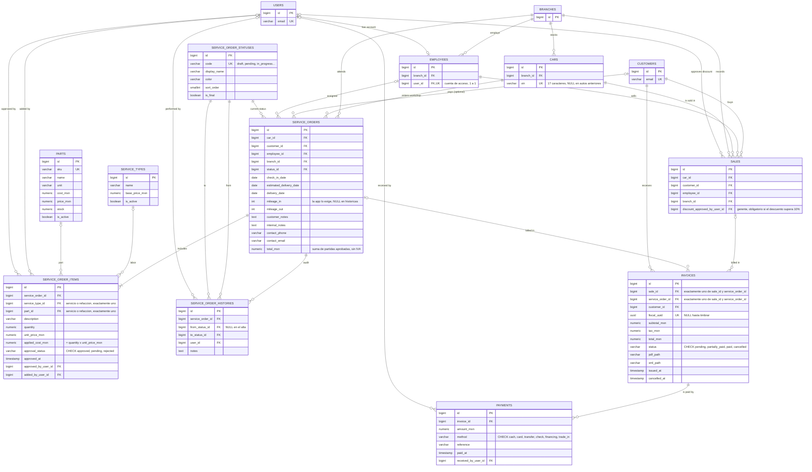

# Arquitectura y modelo de datos: módulo de servicio y ventas

Define el esquema (PostgreSQL) y las reglas de negocio del flujo operativo de la agencia: ingreso de vehículos al taller, costos extra no previstos, facturación, pagos y la relación entre usuarios y sucursales.

> **Ventas:** la venta de vehículos (accesorios, autos a cuenta, financiamiento, transferencias y comisiones) se describe en [`arquitectura-ventas.md`](arquitectura-ventas.md). Comparte con este documento las tablas `invoices` y `payments`.
>
> **Estado:** el esquema de este documento está implementado en las migraciones de `backend/database/migrations/` y en `database/schema/01_schema.sql`. Las reglas de la sección 4 en adelante (máquina de estados, permisos, recalculo de totales, existencias) **todavía no están implementadas en código**: son el diseño que deben seguir los controllers, repositories y servicios.

## Contenido

1. [Ajustes a la propuesta original](#1-ajustes-a-la-propuesta-original)
2. [Modelo de datos](#2-modelo-de-datos)
3. [Qué garantiza la base de datos](#3-qué-garantiza-la-base-de-datos)
4. [Reglas de negocio y flujos](#4-reglas-de-negocio-y-flujos)
5. [Roles y permisos](#5-roles-y-permisos)
6. [Flujo del caso de uso](#6-flujo-del-caso-de-uso)
7. [Implementación en Laravel](#7-implementación-en-laravel)
8. [Datos existentes](#8-datos-existentes)
9. [Decisiones abiertas](#9-decisiones-abiertas)
10. [Notas de PostgreSQL](#10-notas-de-postgresql)

## 1. Ajustes a la propuesta original

La propuesta inicial era buena en lo esencial (catálogo de estatus, bitácora, aprobación de extras, vínculo usuario-empleado). Estos son los cambios que se hicieron al contrastarla con el esquema real y los datos existentes:

| Propuesta | Decisión | Por qué |
| --- | --- | --- |
| `INVOICES` polimórfica (`invoiceable_id`, `invoiceable_type`) | Dos llaves foráneas reales, `sale_id` y `service_order_id`, con un `CHECK` que exige exactamente una | PostgreSQL no puede validar llaves polimórficas: una factura podía apuntar a un registro borrado o inexistente |
| `uuid` como folio fiscal obligatorio | `fiscal_uuid`, **nullable** y único | El UUID del CFDI lo asigna el PAC al timbrar. Antes de eso la factura ya existe |
| `pdf_url`, `xml_url` | `pdf_path`, `xml_path` | Se guarda la ruta en el almacenamiento. Una URL cambia y caduca |
| El pago se mencionaba en el flujo, sin tabla | Tabla `payments` | Sin ella no hay forma de saber si una factura está pagada, ni de aceptar anticipos |
| Estatus con `name` y `display_name` | `code` y `display_name`, con los 7 estatus insertados por la migración | Evita confundir `name` con el texto visible. El código depende de esos valores y los tests no ejecutan seeders |
| Bitácora con `status_id` y `employee_id` | `from_status_id`, `to_status_id` y `user_id`, solo de inserción | Una auditoría necesita saber de dónde vino el cambio. Quien actúa es el usuario autenticado, que no siempre es un empleado (el admin) |
| Renombrar `SERVICE_TYPES` a `CATALOG_ITEMS` | **No se renombra.** Tabla `parts` aparte | Renombrar rompe las 20 filas y las llaves foráneas existentes. Además, refacciones y mano de obra tienen ciclo de vida distinto (existencias, costo) |
| `current_mileage` en `CARS` | **No se agrega** | `cars.mileage` ya es el último kilometraje registrado. Duplicarlo crea dos fuentes de verdad |
| `actual_delivery_date` en órdenes | **No se agrega** | `service_orders.delivery_date` ya es la fecha real de entrega |
| `is_approved_by_customer` (booleano) | `approval_status` (`approved`, `pending`, `rejected`) con `approved_at` y `approved_by_user_id` | Un booleano no distingue "espera respuesta" de "el cliente lo rechazó" |
| `added_by_employee_id` | `added_by_user_id` | Mismo criterio que la bitácora |
| `unit_price` y `quantity` junto a `applied_cost_mxn` | Se conservan los tres, más `description`, y un `CHECK`: `applied_cost_mxn = round(quantity × unit_price_mxn, 2)` | Evita que el total de una partida contradiga su cantidad y precio. `description` guarda el nombre al momento de la orden, para que cambiar el catálogo no altere órdenes cobradas |
| `mileage_in` "obligatorio" | Obligatorio **en la aplicación**, nullable en la base | Las 4,008 órdenes históricas no lo tienen. La base sí garantiza que sea coherente (`>= 0` y salida `>=` entrada) |
| Login con "JWT/Sanctum" | JWT | Es lo que usa el proyecto |
| Flujo: el asesor captura la orden y los servicios "(`pending`)" | La orden nace en `draft` y pasa a `pending` al enviarse al taller | El flujo y la máquina de estados se contradecían |
| (no estaba) | `service_types.is_active`, índices en las llaves foráneas, `CHECK` de integridad, índices únicos parciales de facturas | Ver secciones 3 y 10 |

## 2. Modelo de datos

Las tablas de contexto (`BRANCHES`, `CUSTOMERS`, `EMPLOYEES`, `CARS`, `SALES`, `USERS`) solo muestran sus llaves. Todas las tablas tienen además `created_at` y `updated_at`, salvo `service_order_histories`, que solo tiene `created_at` porque es de solo inserción. El diagrama completo de la base está en [`diagrama-er.md`](diagrama-er.md).

### 2.1 Tablas nuevas

| Tabla | Para qué sirve |
| --- | --- |
| `service_order_statuses` | Catálogo de la máquina de estados: `code` único (`in_progress`), `display_name`, `color` hexadecimal para la interfaz, `sort_order` e `is_final` |
| `service_order_histories` | Bitácora de cambios de estatus: orden, estatus anterior y nuevo, usuario, notas y fecha. Solo de inserción |
| `parts` | Refacciones e insumos: `sku` único, `unit`, `cost_mxn`, `price_mxn` (sin IVA), `stock` (admite fracciones, por ejemplo litros) y `is_active` |
| `invoices` | Facturas de una venta **o** de una orden. Receptor (`customer_id`), `fiscal_uuid`, `subtotal_mxn`, `tax_mxn`, `total_mxn`, `status`, rutas del PDF y XML, `issued_at` y `cancelled_at` |
| `payments` | Pagos aplicados a una factura, de una orden o de una venta: monto, `method` (`cash`, `card`, `transfer`, `check`, y para ventas `financing` y `trade_in`), referencia, `paid_at` y quién lo recibió. Una factura admite varios (anticipo y liquidación) |

### 2.2 Tablas modificadas

**`employees`**
- `is_active` (por defecto `true`): un empleado nunca se borra, se da de baja. Conserva su historial de ventas y órdenes.
- `user_id` (FK a `users`, **único**, `ON DELETE SET NULL`): una cuenta de acceso por empleado. Al autenticar, `$user->employee->branch_id` da la sucursal. Un usuario sin empleado (el admin) no pertenece a ninguna sucursal.

**`cars`**
- `vin` (17 caracteres, único, validado con `CHECK`: letras y dígitos sin `I`, `O` ni `Q`), `license_plate` (indexada), `color`.
- `vin` es `NULL` en los 2,417 autos anteriores al módulo (son datos sintéticos). La aplicación debe exigirlo al dar de alta autos nuevos.
- `mileage` ya existía y se mantiene como **último kilometraje registrado**: se actualiza con cada orden.

**`service_types`**
- `is_active`. Un servicio dado de baja se desactiva, no se borra, porque las partidas lo referencian.

**`service_orders`**

| Columna | Detalle |
| --- | --- |
| `car_id` | Ahora `NOT NULL` |
| `branch_id` | `NOT NULL`. Se toma de la sucursal del empleado que crea la orden, nunca del cliente HTTP |
| `status_id` | `NOT NULL`, FK a `service_order_statuses` |
| `estimated_delivery_date` | Fecha prometida. No puede ser anterior al ingreso |
| `delivery_date` | Fecha real de entrega (ya existía). No puede ser anterior al ingreso |
| `mileage_in`, `mileage_out` | Kilometraje de entrada y salida. Salida `>=` entrada |
| `customer_notes` | Lo que reporta el cliente |
| `internal_notes` | Notas del taller, no visibles al cliente |
| `contact_phone`, `contact_email` | Copia de los datos del cliente al momento de la orden |
| `total_mxn` | Suma de las partidas **aprobadas**, sin IVA. Valor inicial `0` |

**`service_order_items`**

| Columna | Detalle |
| --- | --- |
| `service_order_id` | `NOT NULL`, `ON DELETE RESTRICT` |
| `service_type_id` / `part_id` | Exactamente uno de los dos: servicio (mano de obra) o refacción |
| `description` | Nombre al momento de la orden |
| `quantity` | Mayor que cero, admite fracciones. Por defecto `1` |
| `unit_price_mxn` | Precio unitario, sin IVA |
| `applied_cost_mxn` | Total de la partida: `quantity × unit_price_mxn` |
| `approval_status` | `approved` (por defecto), `pending` o `rejected` |
| `approved_at`, `approved_by_user_id` | Cuándo y quién registró la respuesta del cliente |
| `added_by_user_id` | Quién agregó la partida |

## 3. Qué garantiza la base de datos

Estas reglas no dependen de que la aplicación se porte bien: PostgreSQL las rechaza.

| Regla | Cómo |
| --- | --- |
| Una orden siempre tiene auto, sucursal y estatus | `NOT NULL` y llave foránea |
| No se borra un auto, cliente, empleado, sucursal, estatus, servicio o refacción con órdenes o partidas | `ON DELETE RESTRICT` |
| No se borra una orden con partidas, bitácora o factura, ni una factura con pagos | `ON DELETE RESTRICT` |
| Cada partida es un servicio **o** una refacción | `CHECK (num_nonnulls(service_type_id, part_id) = 1)` |
| El total de la partida es cantidad × precio unitario | `CHECK (applied_cost_mxn = round(quantity * unit_price_mxn, 2))` |
| Cantidad mayor que cero, precios no negativos | `CHECK` |
| El estado de aprobación es válido | `CHECK (approval_status IN ('approved','pending','rejected'))` |
| Fechas coherentes (entrega estimada y real no anteriores al ingreso) | `CHECK` |
| Kilometraje no negativo y salida mayor o igual a entrada | `CHECK` |
| Las existencias nunca son negativas | `CHECK (stock >= 0)` |
| `sku`, `vin`, `fiscal_uuid` y `user_id` de empleado no se repiten | `UNIQUE` (los `NULL` no cuentan como repetidos) |
| El VIN tiene formato válido | `CHECK` con expresión regular |
| Una factura es de una venta **o** de una orden | `CHECK (num_nonnulls(sale_id, service_order_id) = 1)` |
| `total = subtotal + IVA` | `CHECK` |
| Una factura está cancelada si y solo si tiene fecha de cancelación | `CHECK` |
| Solo una factura **vigente** por venta y por orden (una cancelada permite emitir otra) | Índice único parcial `WHERE status <> 'cancelled'` |
| Un pago es mayor que cero y con método válido | `CHECK` |
| La bitácora no registra un cambio al mismo estatus | `CHECK (from_status_id IS NULL OR from_status_id <> to_status_id)` |
| Un usuario es a lo mucho un empleado | `UNIQUE` en `employees.user_id` |

**Lo que la base no puede garantizar** y debe hacer la aplicación: las transiciones válidas de estatus, que `total_mxn` coincida con la suma de partidas, que la suma de pagos no exceda el total de la factura, que `mileage_in` sea obligatorio al crear una orden y que el kilometraje no retroceda respecto a `cars.mileage`. Se detallan en las secciones 4 y 7.

## 4. Reglas de negocio y flujos

### 4.1 Máquina de estados de la orden

| Estatus (`code`) | Significado | Final |
| --- | --- | :---: |
| `draft` | Captura del asesor | |
| `pending` | Enviada al taller | |
| `pending_approval` | Esperando el visto bueno del cliente por un extra | |
| `in_progress` | El mecánico trabaja | |
| `completed` | Auto listo, esperando entrega y pago | |
| `delivered` | Entregado, pagado y facturado | ✅ |
| `cancelled` | Cancelada | ✅ |

**Transiciones permitidas.** Cualquier otra se rechaza. Desde un estatus final no sale ninguna.

| De | A | Acción | Permiso | Condición |
| --- | --- | --- | --- | --- |
| (alta) | `draft` | Crear la orden | `service_orders.create` | `mileage_in` capturado |
| `draft` | `pending` | Enviar al taller | `service_orders.create` | Al menos una partida aprobada |
| `pending` | `in_progress` | Programar y empezar | `service_orders.schedule` | |
| `in_progress` | `pending_approval` | Reportar un extra | `service_orders.add_extra` | Se agrega una partida `pending` |
| `pending_approval` | `in_progress` | Registrar la respuesta del cliente | `service_orders.approve_extra` | Ninguna partida queda `pending` |
| `in_progress` | `completed` | Terminar | `service_orders.complete` | Sin partidas `pending`, `mileage_out` capturado y `>= mileage_in` |
| `completed` | `delivered` | Entregar | `service_orders.deliver` | Factura emitida y pagada por completo |
| `completed` | `in_progress` | Reabrir por retrabajo | `service_orders.reopen` | Nota obligatoria |
| `draft`, `pending` | `cancelled` | Cancelar | `service_orders.cancel` | Nota obligatoria |
| `in_progress`, `pending_approval`, `completed` | `cancelled` | Cancelar con trabajo iniciado | `service_orders.cancel_started` | Nota obligatoria |

Cada transición escribe una fila en `service_order_histories` dentro de **la misma transacción** que actualiza el estatus.

### 4.2 El costo extra (scope creep)

1. El mecánico agrega la partida con `approval_status = 'pending'` y la orden pasa a `pending_approval`.
2. El asesor contacta al cliente.
3. **Si acepta:** la partida pasa a `approved`, con `approved_at` y `approved_by_user_id`. El total se recalcula.
4. **Si rechaza:** la partida pasa a `rejected` y se conserva para auditoría. No suma al total. La nota con el motivo va en la bitácora.
5. Cuando ya no quedan partidas `pending`, la orden vuelve a `in_progress`.

### 4.3 Totales, IVA y facturación

- `service_orders.total_mxn` = suma de `applied_cost_mxn` de las partidas **aprobadas**, **sin IVA**. Se recalcula en la misma transacción en que cambia una partida.
- La factura calcula el IVA: `subtotal_mxn` = total de la orden, `tax_mxn` = `round(subtotal × tasa, 2)`, con la tasa en configuración (16 %), y `total_mxn` = suma de ambos.
- Una orden **sin cliente** (auto de la agencia) es un gasto interno: no se factura, porque `invoices.customer_id` es obligatorio.
- El estatus de la factura sale de sus pagos: `pending` sin pagos, `partially_paid` si suman menos que el total, `paid` si lo cubren. Cancelar una factura exige `cancelled_at` y permite emitir otra.
- La suma de los pagos de una factura **no puede exceder** su total (se valida en la aplicación).

### 4.4 Kilometraje

- `mileage_in` es obligatorio al crear la orden y no debe ser menor que `cars.mileage`. Si lo es (odómetro cambiado o error de captura), la aplicación pide confirmación de un gerente.
- Al completar la orden, `cars.mileage` se actualiza a `max(cars.mileage, mileage_out)`.

### 4.5 Refacciones y existencias

- Al aprobar una partida de refacción se descuentan las existencias, dentro de la misma transacción y con la fila de `parts` bloqueada (`lockForUpdate()`). Si no alcanzan, el `CHECK (stock >= 0)` lo impide y la aplicación responde con un error claro.
- Al rechazar o cancelar se devuelven.
- Sin una tabla de movimientos de inventario no hay historial de existencias. Si el control de inventario crece, la siguiente tabla es `stock_movements` (ver sección 9).

### 4.6 Alcance por sucursal

- Los asesores y mecánicos solo ven órdenes de **su** sucursal: el repository filtra por `branch_id` del empleado ligado al usuario.
- Un usuario sin empleado (admin) o con el permiso `service_orders.view_all_branches` ve todas.
- La sucursal de una orden nueva sale del empleado autenticado, nunca del cuerpo de la petición.

### 4.7 Concurrencia

Dos usuarios pueden actuar sobre la misma orden a la vez (el mecánico reporta un extra mientras el asesor la cancela). Cada transición debe:

1. Abrir una transacción.
2. Leer la orden con `lockForUpdate()`.
3. Comprobar que el estatus actual sigue siendo el esperado y que la transición es válida.
4. Actualizar el estatus, recalcular el total y escribir la bitácora.

Así, la segunda petición encuentra el estatus ya cambiado y falla en lugar de sobrescribir.

### 4.8 Qué autos se atienden y a nombre de quién

El taller **solo atiende autos de las sucursales** (los que están en `cars`): inventario, autos vendidos y autos recibidos a cuenta. No se reciben autos de otras agencias ni de particulares ajenos a la agencia, por lo que `service_orders.car_id` apunta siempre a `cars` y no hace falta un registro aparte de vehículos de clientes.

`customer_id` (quien paga) depende de la situación del auto en el momento del ingreso:

| Situación del auto | `customer_id` | Quién paga |
| --- | --- | --- |
| Tiene una venta cerrada vigente | **El comprador** de esa venta (obligatorio) | El cliente. La orden se factura |
| Es del inventario (`new` o `used`), o todavía no se había vendido (revisión previa a la venta) | `NULL` | La agencia. Es un gasto interno y no se factura |

Es una regla de la aplicación: PostgreSQL no puede comparar `service_orders.customer_id` con `sales.customer_id` en un `CHECK`. Los 4,008 registros existentes la cumplen: las 3,389 órdenes con cliente son del comprador y posteriores a la venta, y las 619 sin cliente son revisiones previas o autos de inventario.

## 5. Roles y permisos

Los roles son los del proyecto (`admin`, `manager`, `seller`, `service_advisor`, `mechanic`). `admin` tiene todos los permisos. El "Jefe de taller" de la propuesta original existe como **puesto** (`04 Jefe Mecánico` en `job_titles`), pero todavía no como rol propio del sistema (ver sección 9). `job_title_role` le sugiere `mechanic`.

| Permiso | Asesor (`service_advisor`) | Mecánico (`mechanic`) | Gerente (`manager`) |
| :--- | :---: | :---: | :---: |
| `customers.view_any` | ✅ | ✅ | ✅ |
| `cars.view_any`, `cars.view` | ✅ | ✅ | ✅ |
| `service_orders.view_any`, `service_orders.view` | ✅ | ✅ | ✅ |
| `service_orders.create` | ✅ | ❌ | ✅ |
| `service_orders.update` (fechas, notas del cliente) | ✅ | ❌ | ✅ |
| `service_orders.schedule` | ❌ | ✅ | ✅ |
| `service_orders.add_extra` | ❌ | ✅ | ✅ |
| `service_orders.approve_extra` | ✅ | ❌ | ✅ |
| `service_orders.complete` | ❌ | ✅ | ✅ |
| `service_orders.deliver` | ✅ | ❌ | ✅ |
| `service_orders.cancel` | ✅ | ❌ | ✅ |
| `service_orders.cancel_started` | ❌ | ❌ | ✅ |
| `service_orders.reopen` | ❌ | ❌ | ✅ |
| `service_orders.view_all_branches` | ❌ | ❌ | ❌ (solo `admin`) |
| `parts.view_any`, `parts.view` | ✅ | ✅ | ✅ |
| `parts.update` (ajustar existencias) | ❌ | ❌ | ✅ |
| `invoices.view_any`, `invoices.view` | ✅ | ❌ | ✅ |
| `invoices.create` | ✅ | ❌ | ✅ |
| `invoices.cancel` | ❌ | ❌ | ✅ |
| `payments.create` | ✅ | ❌ | ✅ |

Los permisos siguen la convención `<recurso>.<acción>` del proyecto. Para crearlos se agregan a `PermissionsSeeder::RESOURCES` y a los menús que correspondan (ver el README, sección "Permisos y menú"). Notas internas del taller (`internal_notes`): las ve y edita quien tenga `service_orders.schedule` o `service_orders.complete`.

## 6. Flujo del caso de uso

1. **Ingreso.** El asesor, ya autenticado, crea la orden: elige cliente y auto, captura `mileage_in`, `customer_notes`, la fecha estimada y las partidas iniciales. La orden nace en `draft` con la sucursal del asesor, y se copian el teléfono y el correo del cliente a `contact_phone` y `contact_email`. Al enviarla al taller pasa a `pending`.
2. **Taller.** El mecánico programa la orden y la pasa a `in_progress`.
3. **Imprevisto.** El mecánico agrega una partida extra (`pending`) y la orden pasa a `pending_approval`. El asesor llama al cliente y registra la respuesta (`approved` o `rejected`). La orden vuelve a `in_progress` y el total se recalcula.
4. **Finalización.** El mecánico termina, captura `mileage_out` y marca `completed`. `cars.mileage` se actualiza.
5. **Facturación y pago.** El asesor genera la factura (`invoices`) a partir del total de la orden y registra uno o varios pagos (`payments`) hasta cubrirla.
6. **Entrega.** Con la factura pagada, el asesor entrega el auto y la orden pasa a `delivered`. Queda en estatus final.

**Caminos alternos:** el cliente rechaza un extra (la partida queda `rejected`), se cancela la orden (nota obligatoria) o se reabre una orden `completed` por retrabajo.

## 7. Implementación en Laravel

- **Estatus como enum de PHP** (`ServiceOrderStatus`) con los `code` del catálogo y un método `canTransitionTo()` que implemente la tabla de la sección 4.1. Es la fuente de verdad de las transiciones en código.
- **Un servicio** (`ServiceOrderWorkflow`) con un método por transición (`send()`, `start()`, `reportExtra()`, `resolveExtra()`, `complete()`, `deliver()`, `cancel()`, `reopen()`). Cada uno aplica la receta de la sección 4.7. Los controllers no cambian estatus directamente.
- **Repositories y DTOs** como en el resto del proyecto: el repository de órdenes aplica el alcance por sucursal (4.6) y el filtrado de `/filter` (ver [`filtros-avanzados.md`](filtros-avanzados.md)). Los DTOs de entrada llevan `mileage_in` y las partidas, y la sucursal se calcula en el servicio.
- **Dinero:** usar cadenas decimales o una librería de decimales (`brick/math`), no `float`. Redondear a 2 decimales con `round(..., 2)` igual que el `CHECK` de la base.
- **Eventos** (`ServiceOrderStatusChanged`) para desacoplar avisos al cliente o a la interfaz. La bitácora no debe depender de un listener: se escribe en la transacción.
- **Permisos** con `middleware('permission:...')` en la ruta para los casos simples, y comprobación en el servicio para las transiciones, porque un mismo endpoint puede mover varias.
- **Vínculo usuario-empleado:** al crear un usuario para un empleado se le asigna el rol que corresponde a su puesto (`job_titles`) en una sola operación, para que puesto y rol no se desalineen. El rol sugerido para cada puesto está en `job_title_role`, que solo precarga la selección. Con qué autos trabaja cada empleado (por ejemplo, un mecánico solo de camionetas) está en `employee_specializations`: la aplicación debe validarlo al asignar la orden y permitir que un gerente la salte con una nota (ver decisión 17 de `decisiones.md`).

## 8. Datos existentes

- Las **4,008 órdenes y 6,370 partidas** históricas se cargan como `delivered`, con la sucursal del auto, precio unitario igual al costo aplicado, cantidad `1` y la descripción copiada del servicio.
- No tienen `mileage_in`, `mileage_out`, notas ni datos de contacto (son `NULL`), ni bitácora, ni factura, ni pagos. Las reglas de "entregar exige factura pagada" aplican a las transiciones nuevas, no a esas filas.
- Los seeds (`02_seed_manual.sql` y `seed.py`) llenan las columnas nuevas que son obligatorias. Las 16,336 filas anteriores se compararon con las nuevas y son idénticas.

## 9. Decisiones abiertas

Ya resuelta: **el alcance son solo los autos de las sucursales** (4.8). No hay autos externos.

1. **Puesto y rol del "Jefe Mecánico".** Existe el puesto `04 Jefe Mecánico` en `job_titles`, pero no hay un rol con sus permisos: hoy sus tareas recaen en `mechanic` y `manager`. La correspondencia puesto → rol ya se guarda en `job_title_role` (el `04` sugiere `mechanic`, de forma provisional). Falta decidir si el jefe mecánico necesita un rol propio, por ejemplo para aprobar o reasignar órdenes.
2. **Inventario de refacciones.** `parts.stock` es un saldo sin historial. Para auditar entradas y salidas hace falta `stock_movements` (parte, cantidad con signo, motivo, orden y usuario).
3. **Timbrado fiscal.** El esquema guarda el resultado (`fiscal_uuid`, rutas del PDF y XML), pero la integración con el PAC no está diseñada.
4. **Garantía, devoluciones y notas de crédito.** La garantía se gestiona **por medio del seguro**, y todavía no se sabe cómo entra ese proceso al sistema (qué dispara un reclamo, quién paga la reparación y cómo se registra). Por eso la reapertura de una orden (`completed` → `in_progress`) se entiende solo como **retrabajo** y no se liga a la garantía. Hoy solo se cancela la factura completa: no hay pagos negativos ni facturas parciales.
5. **Varios mecánicos por orden.** `service_orders.employee_id` es un solo empleado. Si se necesita registrar quién hizo cada trabajo, la partida debería llevar su propio empleado.
6. **Inmutabilidad real de la bitácora.** Hoy es solo de inserción por convención de la aplicación. Si hace falta garantía en la base, un trigger que rechace `UPDATE` y `DELETE` en `service_order_histories`.

## 10. Notas de PostgreSQL

- Todas las tablas y columnas del módulo tienen un comentario en la base (`COMMENT ON`) que explica su significado y valores válidos. Es el diccionario de datos: `\d+ service_orders` en `psql`.
- Dinero en `NUMERIC(p,2)`. Nunca `FLOAT`.
- Estatus como tabla catálogo (`service_order_statuses`) y valores cortos con `CHECK` (`approval_status`, `invoices.status`, `payments.method`). No se usa `ENUM` nativo.
- Llaves foráneas con `ON DELETE RESTRICT` en todo lo que forma historial. `SET NULL` solo para referencias a `users`, para no perder la bitácora si se elimina una cuenta.
- PostgreSQL **no crea índices en las llaves foráneas**. Se agregaron en las tablas de este módulo (por ejemplo `service_orders.car_id`, `status_id` y el compuesto `branch_id, status_id` para el tablero del taller). Las tablas anteriores (`sales`, `employees`...) no los tienen todavía: conviene agregarlos cuando crezcan.
- Las fechas de evento (`approved_at`, `paid_at`, `issued_at`) son `timestamp` sin zona horaria, como el resto del proyecto. La aplicación trabaja en UTC (`config/app.php`).
- Un `UNIQUE` permite varios `NULL`, por eso `vin`, `fiscal_uuid` y `employees.user_id` aceptan filas sin valor y siguen siendo únicos cuando lo tienen.
