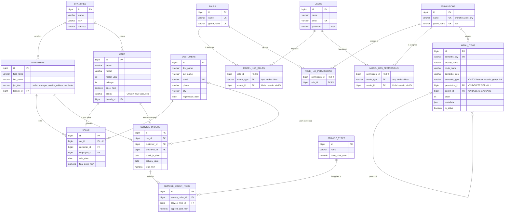

# Diagrama ER

Base de datos `agencia` (PostgreSQL). Incluye las tablas del negocio y las de usuarios, roles, permisos y menú.

**Leyenda**
- `PK` llave primaria, `FK` llave foránea, `UK` única.
- Todas las tablas tienen además `created_at` y `updated_at`, que no se dibujan. `users` omite también `remember_token` y `email_verified_at`.
- `model_has_roles` y `model_has_permissions` (Spatie) son polimórficas: `model_type` y `model_id` identifican al usuario, pero no son una llave foránea real, por eso `users` se conecta a ellas solo en el diagrama.
- `users` todavía no se relaciona con `employees`.
- No se dibujan las tablas internas de Laravel: `migrations`, `cache`, `cache_locks`, `jobs`, `job_batches`, `failed_jobs`, `sessions` y `password_reset_tokens`.
- Detalle de las tablas del negocio en [`er.md`](er.md). Cómo se unen permisos y menú, en el [README](../README.md#permisos-y-menú).
