# Diagrama ER

Base de datos `agencia` (PostgreSQL). Incluye las tablas del negocio, el módulo de ventas (con sus reglas de comisión), el de servicio (órdenes, facturas y pagos) y las de usuarios, roles, permisos y menú.

```mermaid
erDiagram
    %% Negocio
    BRANCHES ||--o{ EMPLOYEES : "employs"
    JOB_TITLES ||--o{ EMPLOYEES : "holds"
    VEHICLE_TYPES ||--o{ CARS : "classifies"
    EMPLOYEES ||--o{ EMPLOYEE_SPECIALIZATIONS : "works with"
    VEHICLE_TYPES |o--o{ EMPLOYEE_SPECIALIZATIONS : "allows"
    JOB_TITLES ||--o{ JOB_TITLE_ROLE : "suggests"
    ROLES ||--o{ JOB_TITLE_ROLE : "is suggested"
    BRANCHES ||--o{ CARS : "stocks"
    USERS |o--o| EMPLOYEES : "has account"

    %% Ventas
    CUSTOMERS ||--o{ SALES : "buys"
    EMPLOYEES ||--o{ SALES : "owns"
    BRANCHES ||--o{ SALES : "records"
    CARS ||--o{ SALES : "is sold in"
    USERS |o--o{ SALES : "approves discount"
    SALES ||--o{ SALE_ADDONS : "includes"
    PARTS |o--o{ SALE_ADDONS : "inventory item"
    SALES ||--o{ SALE_TRADE_INS : "receives"
    CARS |o--o{ SALE_TRADE_INS : "becomes"
    SALES ||--o| SALE_FINANCINGS : "is financed by"
    SALES ||--o{ SALE_TRANSFERS : "is transferred"
    EMPLOYEES ||--o{ SALE_TRANSFERS : "from"
    EMPLOYEES ||--o{ SALE_TRANSFERS : "to"
    USERS |o--o{ SALE_TRANSFERS : "authorizes"
    SALES ||--|{ SALE_COMMISSIONS : "generates"
    EMPLOYEES ||--o{ SALE_COMMISSIONS : "earns"
    BRANCHES |o--o{ COMMISSION_RULES : "applies to"
    COMMISSION_RULES ||--o{ SALE_COMMISSIONS : "is applied in"

    %% Taller
    BRANCHES ||--o{ SERVICE_ORDERS : "attends"
    CARS ||--o{ SERVICE_ORDERS : "enters workshop"
    CUSTOMERS |o--o{ SERVICE_ORDERS : "pays (optional)"
    EMPLOYEES |o--o{ SERVICE_ORDERS : "assigned"
    SERVICE_ORDER_STATUSES ||--o{ SERVICE_ORDERS : "current status"
    SERVICE_ORDERS ||--|{ SERVICE_ORDER_ITEMS : "includes"
    SERVICE_TYPES |o--o{ SERVICE_ORDER_ITEMS : "labor"
    PARTS |o--o{ SERVICE_ORDER_ITEMS : "part"
    SERVICE_ORDERS ||--o{ SERVICE_ORDER_HISTORIES : "audit"
    SERVICE_ORDER_STATUSES ||--o{ SERVICE_ORDER_HISTORIES : "from"
    SERVICE_ORDER_STATUSES ||--o{ SERVICE_ORDER_HISTORIES : "to"
    USERS |o--o{ SERVICE_ORDER_HISTORIES : "performed by"
    USERS |o--o{ SERVICE_ORDER_ITEMS : "added by"
    USERS |o--o{ SERVICE_ORDER_ITEMS : "approved by"

    %% Facturación (ventas y taller)
    SALES |o--o{ INVOICES : "billed in"
    SERVICE_ORDERS |o--o{ INVOICES : "billed in"
    CUSTOMERS ||--o{ INVOICES : "receives"
    INVOICES ||--o{ PAYMENTS : "is paid by"
    USERS |o--o{ PAYMENTS : "received by"

    %% Usuarios, roles, permisos y menú
    USERS ||--o{ MODEL_HAS_ROLES : "has roles"
    ROLES ||--o{ MODEL_HAS_ROLES : "is assigned"
    ROLES ||--o{ ROLE_HAS_PERMISSIONS : "groups"
    PERMISSIONS ||--o{ ROLE_HAS_PERMISSIONS : "belongs to"
    USERS ||--o{ MODEL_HAS_PERMISSIONS : "has direct"
    PERMISSIONS ||--o{ MODEL_HAS_PERMISSIONS : "is assigned"
    PERMISSIONS |o--o{ MENU_ITEMS : "controls"
    MENU_ITEMS |o--o{ MENU_ITEMS : "parent of"

    BRANCHES {
        bigint id PK
        varchar name
        varchar city
        varchar address
    }

    CUSTOMERS {
        bigint id PK
        varchar first_name
        varchar last_name
        varchar email UK
        varchar phone
        varchar city
        date registration_date
    }

    EMPLOYEES {
        bigint id PK
        varchar first_name
        varchar last_name
        bigint job_title_id FK
        bigint branch_id FK
        bigint user_id FK, UK "cuenta de acceso, 1 a 1"
        boolean is_active "baja logica, nunca se borra"
    }

    JOB_TITLES {
        bigint id PK
        varchar code UK "dos digitos, 01 vendedor, 05 mecanico"
        varchar name
        boolean is_active "se desactiva, no se borra"
    }

    VEHICLE_TYPES {
        bigint id PK
        varchar code UK "auto, suv, pickup, van, truck"
        varchar name
        boolean is_active "se desactiva, no se borra"
    }

    EMPLOYEE_SPECIALIZATIONS {
        bigint id PK
        bigint employee_id FK "ON DELETE CASCADE"
        bigint vehicle_type_id FK "NULL: cualquier tipo"
        varchar car_condition "CHECK new, used, all"
    }

    CARS {
        bigint id PK
        varchar brand
        varchar model
        bigint vehicle_type_id FK
        int model_year
        int mileage
        numeric price_mxn
        varchar status "CHECK new, used, sold"
        bigint branch_id FK
        varchar vin UK "17 caracteres, NULL en autos anteriores"
        varchar license_plate
        varchar color
    }

    SALES {
        bigint id PK
        bigint car_id FK
        bigint customer_id FK
        bigint employee_id FK
        bigint branch_id FK
        varchar status "CHECK draft, completed, cancelled"
        date sale_date
        varchar car_status_at_sale "new o used, para restaurar al cancelar"
        numeric list_price_mxn
        numeric discount_mxn
        bigint discount_approved_by_user_id FK "gerente, obligatorio si el descuento supera 10%"
        numeric final_price_mxn "= lista - descuento, con IVA"
        numeric tax_mxn "IVA contenido en el precio final"
        numeric net_sale_price_mxn "auto mas accesorios sin IVA, base de la comision, NULL en borrador"
        text notes
        timestamp superseded_at "el auto volvio al inventario a cuenta de otra venta"
        timestamp cancelled_at
        text cancellation_reason
    }

    SALE_ADDONS {
        bigint id PK
        bigint sale_id FK
        bigint part_id FK "NULL si no es de inventario"
        varchar description
        numeric quantity
        numeric unit_price_mxn
        numeric total_mxn
    }

    SALE_TRADE_INS {
        bigint id PK
        bigint sale_id FK
        bigint car_id FK "NULL hasta cerrar la venta"
        varchar vin "copia, no crea el auto en cars hasta cerrar"
        varchar brand
        varchar model
        int model_year
        int mileage
        varchar license_plate
        varchar color
        numeric valuation_price_mxn
        text condition_notes
    }

    SALE_FINANCINGS {
        bigint id PK
        bigint sale_id FK, UK "maximo un financiamiento por venta"
        varchar lender_type "CHECK bank, internal"
        varchar bank_name
        varchar status "CHECK pending, approved, rejected, disbursed"
        timestamp approved_at
        numeric down_payment_mxn
        numeric financed_amount_mxn
        smallint months
        numeric interest_rate
    }

    SALE_TRANSFERS {
        bigint id PK
        bigint sale_id FK
        bigint from_employee_id FK
        bigint to_employee_id FK
        text reason
        bigint authorized_by_user_id FK "NULL si el dueño transfiere su borrador"
    }

    SALE_COMMISSIONS {
        bigint id PK
        bigint sale_id FK, UK
        bigint employee_id FK, UK
        bigint commission_rule_id FK "regla aplicada"
        varchar role "CHECK sole, capturer, closer"
        numeric percentage "parte del reparto, 0.01 a 100"
        numeric base_amount_mxn "copia de sales.net_sale_price_mxn"
        numeric commission_rate "copia de la tasa de la regla"
        numeric commission_amount_mxn "= base x tasa x porcentaje / 100"
    }

    COMMISSION_RULES {
        bigint id PK
        bigint branch_id FK "NULL: regla global"
        varchar car_condition "CHECK new, used, all"
        numeric rate "fraccion: 0.0150 = 1.5 por ciento"
        date effective_from "UNIQUE con sucursal y condicion"
        boolean is_active
    }

    SERVICE_TYPES {
        bigint id PK
        varchar name
        numeric base_price_mxn
        boolean is_active
    }

    SERVICE_ORDER_STATUSES {
        bigint id PK
        varchar code UK "draft, pending, in_progress..."
        varchar display_name
        varchar color
        smallint sort_order
        boolean is_final
    }

    PARTS {
        bigint id PK
        varchar sku UK
        varchar name
        varchar unit
        numeric cost_mxn
        numeric price_mxn
        numeric stock
        boolean is_active
    }

    SERVICE_ORDERS {
        bigint id PK
        bigint car_id FK
        bigint customer_id FK
        bigint employee_id FK
        bigint branch_id FK
        bigint status_id FK
        date check_in_date
        date estimated_delivery_date
        date delivery_date
        int mileage_in "la app lo exige, NULL en historicas"
        int mileage_out
        text customer_notes
        text internal_notes
        varchar contact_phone
        varchar contact_email
        numeric total_mxn "suma de partidas aprobadas, sin IVA"
    }

    SERVICE_ORDER_ITEMS {
        bigint id PK
        bigint service_order_id FK
        bigint service_type_id FK "servicio o refaccion, exactamente uno"
        bigint part_id FK "servicio o refaccion, exactamente uno"
        varchar description
        numeric quantity
        numeric unit_price_mxn
        numeric applied_cost_mxn "= quantity x unit_price_mxn"
        varchar approval_status "CHECK approved, pending, rejected"
        timestamp approved_at
        bigint approved_by_user_id FK
        bigint added_by_user_id FK
    }

    SERVICE_ORDER_HISTORIES {
        bigint id PK
        bigint service_order_id FK
        bigint from_status_id FK "NULL en el alta"
        bigint to_status_id FK
        bigint user_id FK
        text notes
    }

    INVOICES {
        bigint id PK
        bigint sale_id FK "exactamente uno de sale_id y service_order_id"
        bigint service_order_id FK "exactamente uno de sale_id y service_order_id"
        bigint customer_id FK
        uuid fiscal_uuid UK "NULL hasta timbrar"
        numeric subtotal_mxn
        numeric tax_mxn
        numeric total_mxn
        varchar status "CHECK pending, partially_paid, paid, cancelled"
        varchar pdf_path
        varchar xml_path
        timestamp issued_at
        timestamp cancelled_at
    }

    PAYMENTS {
        bigint id PK
        bigint invoice_id FK
        numeric amount_mxn
        varchar method "CHECK cash, card, transfer, check, financing, trade_in"
        varchar reference
        timestamp paid_at
        bigint received_by_user_id FK
    }

    USERS {
        bigint id PK
        varchar name
        varchar email UK
        varchar password "hash"
    }

    ROLES {
        bigint id PK
        varchar name UK
        varchar guard_name UK
    }

    JOB_TITLE_ROLE {
        bigint job_title_id PK, FK
        bigint role_id PK, FK
    }

    PERMISSIONS {
        bigint id PK
        varchar name UK "branches.view_any"
        varchar guard_name UK "api"
    }

    MODEL_HAS_ROLES {
        bigint role_id PK, FK
        varchar model_type PK "App Models User"
        bigint model_id PK "id del usuario, sin FK"
    }

    MODEL_HAS_PERMISSIONS {
        bigint permission_id PK, FK
        varchar model_type PK "App Models User"
        bigint model_id PK "id del usuario, sin FK"
    }

    ROLE_HAS_PERMISSIONS {
        bigint permission_id PK, FK
        bigint role_id PK, FK
    }

    MENU_ITEMS {
        bigint id PK
        varchar semantic_key UK
        varchar display_name
        varchar route_name
        varchar semantic_icon
        varchar semantic_type "CHECK header, module, group, link"
        bigint permission_id FK "ON DELETE SET NULL"
        bigint parent_id FK "ON DELETE CASCADE"
        int order
        json metadata
        boolean is_active
    }
```

**Leyenda**
- `PK` llave primaria, `FK` llave foránea, `UK` única.
- Todas las tablas tienen además `created_at` y `updated_at`, que no se dibujan, salvo `service_order_histories` y `sale_transfers`, que son de solo inserción y solo tienen `created_at`. `users` omite también `remember_token` y `email_verified_at`.
- Cada tabla y cada columna tiene un comentario en la base (`COMMENT ON`) que explica su significado y sus valores. Es el diccionario de datos: `\d+ <tabla>` en `psql`.
- `model_has_roles` y `model_has_permissions` (Spatie) son polimórficas: `model_type` y `model_id` identifican al usuario, pero no son una llave foránea real, por eso `users` se conecta a ellas solo en el diagrama.
- `invoices` apunta a una venta **o** a una orden de servicio, nunca a ambas (`CHECK`). `service_order_items` apunta a un servicio **o** a una refacción. Los pagos de una venta y de una orden usan la misma tabla `payments`.
- No se dibujan las tablas internas de Laravel: `migrations`, `cache`, `cache_locks`, `jobs`, `job_batches`, `failed_jobs`, `sessions` y `password_reset_tokens`.
- Detalle de las tablas del negocio en [`er.md`](er.md). Reglas y flujos en [`arquitectura-ventas.md`](arquitectura-ventas.md) y [`arquitectura_servicios.md`](arquitectura_servicios.md). Cómo se unen permisos y menú, en el [README](../README.md#permisos-y-menú).
