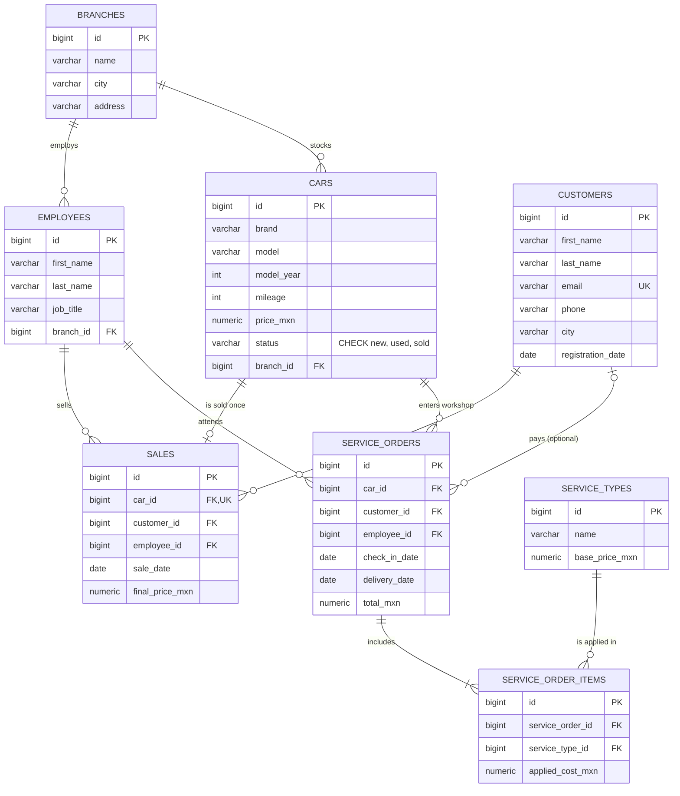

# Modelo de datos: base `agencia`

Agencia de autos con venta de vehículos y taller de servicio, con datos sintéticos. Sirve como fuente para practicar un sistema web (Laravel + Vue con TypeScript) y un pipeline ETL.

Motor: PostgreSQL 17. El esquema vive en dos lugares que deben mantenerse idénticos:

- Migraciones de Laravel: `backend/database/migrations/`
- DDL puro: `database/schema/01_schema.sql`

Los datos se cargan con `database/schema/02_seed_manual.sql` (conjunto pequeño) y `database/seeds-python/seed.py` (volumen). Ver [`database/seeds-python/README.md`](../database/seeds-python/README.md).

## Convenciones

El esquema sigue las convenciones de Laravel, para que Eloquent funcione sin configuración extra:

- Tablas en inglés, plural y `snake_case` (`service_orders`).
- Llave primaria `id` (`BIGSERIAL`).
- Llaves foráneas `<singular>_id` (`branch_id`), con las restricciones nombradas como las genera Laravel.
- `created_at` y `updated_at` en todas las tablas.
- Códigos de estado y puesto en inglés (`sold`, `service_advisor`). Los textos que son datos (nombres de personas, ciudades, nombres de servicios) están en español.

## Diagrama entidad-relación

Todas las tablas tienen además `created_at` y `updated_at` (no se dibujan para no saturar el diagrama).

## Tablas

Todas las llaves foráneas aceptan `NULL`, y ninguna define `ON DELETE` ni `ON UPDATE`: el comportamiento por defecto rechaza el borrado de un registro con hijos. `created_at` y `updated_at` son `TIMESTAMP(0)` sin zona horaria y aceptan `NULL` (Eloquent los llena al crear y actualizar).

### `branches` (sucursales)

| Columna | Tipo | Restricciones |
| --- | --- | --- |
| `id` | BIGSERIAL | PK |
| `name` | VARCHAR(100) | NOT NULL |
| `city` | VARCHAR(50) | NOT NULL |
| `address` | VARCHAR(150) | NOT NULL |

### `customers` (clientes)

| Columna | Tipo | Restricciones |
| --- | --- | --- |
| `id` | BIGSERIAL | PK |
| `first_name` | VARCHAR(50) | NOT NULL |
| `last_name` | VARCHAR(50) | NOT NULL |
| `email` | VARCHAR(100) | NOT NULL, UNIQUE |
| `phone` | VARCHAR(15) | |
| `city` | VARCHAR(50) | |
| `registration_date` | DATE | Por defecto `2023-01-01` |

### `employees` (empleados)

| Columna | Tipo | Restricciones |
| --- | --- | --- |
| `id` | BIGSERIAL | PK |
| `first_name` | VARCHAR(50) | NOT NULL |
| `last_name` | VARCHAR(50) | NOT NULL |
| `job_title` | VARCHAR(50) | NOT NULL. Valores usados: `seller`, `manager`, `service_advisor`, `mechanic` |
| `branch_id` | BIGINT | FK → `branches` |

### `cars` (autos)

| Columna | Tipo | Restricciones |
| --- | --- | --- |
| `id` | BIGSERIAL | PK |
| `brand` | VARCHAR(50) | NOT NULL (marca, por ejemplo `Nissan`) |
| `model` | VARCHAR(50) | NOT NULL (submarca, por ejemplo `Versa`) |
| `model_year` | INTEGER | NOT NULL (año del modelo) |
| `mileage` | INTEGER | NOT NULL (kilometraje) |
| `price_mxn` | NUMERIC(12,2) | NOT NULL (precio de lista) |
| `status` | VARCHAR(10) | NOT NULL, por defecto `'new'`. `CHECK (status IN ('new', 'used', 'sold'))` |
| `branch_id` | BIGINT | FK → `branches` |

### `sales` (ventas)

| Columna | Tipo | Restricciones |
| --- | --- | --- |
| `id` | BIGSERIAL | PK |
| `car_id` | BIGINT | FK → `cars`, UNIQUE (un auto se vende una sola vez) |
| `customer_id` | BIGINT | FK → `customers` |
| `employee_id` | BIGINT | FK → `employees` |
| `sale_date` | DATE | NOT NULL |
| `final_price_mxn` | NUMERIC(12,2) | NOT NULL |

### `service_types` (tipos de servicio)

| Columna | Tipo | Restricciones |
| --- | --- | --- |
| `id` | BIGSERIAL | PK |
| `name` | VARCHAR(100) | NOT NULL |
| `base_price_mxn` | NUMERIC(10,2) | NOT NULL |

### `service_orders` (órdenes de servicio)

| Columna | Tipo | Restricciones |
| --- | --- | --- |
| `id` | BIGSERIAL | PK |
| `car_id` | BIGINT | FK → `cars` |
| `customer_id` | BIGINT | FK → `customers`. `NULL` cuando el auto es de la agencia |
| `employee_id` | BIGINT | FK → `employees` |
| `check_in_date` | DATE | NOT NULL (ingreso al taller) |
| `delivery_date` | DATE | |
| `total_mxn` | NUMERIC(10,2) | NOT NULL |

### `service_order_items` (detalle de servicio)

| Columna | Tipo | Restricciones |
| --- | --- | --- |
| `id` | BIGSERIAL | PK |
| `service_order_id` | BIGINT | FK → `service_orders` |
| `service_type_id` | BIGINT | FK → `service_types` |
| `applied_cost_mxn` | NUMERIC(10,2) | NOT NULL (puede diferir de `base_price_mxn`) |

## Timestamps en los seeds

Los seeds fijan `created_at` y `updated_at` con valores determinísticos derivados de las fechas de negocio, para que la carga sea reproducible:

| Tabla | `created_at` | `updated_at` |
| --- | --- | --- |
| `branches`, `employees`, `service_types` | `2021-01-01` | `2021-01-01` |
| `customers` | `registration_date` | `registration_date` |
| `cars` | `2021-01-01` | `sale_date` si está vendido, si no `2021-01-01` |
| `sales` | `sale_date` | `sale_date` |
| `service_orders` | `check_in_date` | `delivery_date` |
| `service_order_items` | `check_in_date` de su orden | igual que `created_at` |

Las filas que cree la aplicación recibirán la hora real, por lo que una extracción incremental podrá distinguir los datos nuevos de los del seed.

## Equivalencias con los nombres anteriores

El modelo original (MySQL) usaba nombres en español. Los datos son los mismos: se comprobaron fila por fila al renombrar.

| Anterior | Actual |
| --- | --- |
| `sucursales` | `branches` |
| `clientes` | `customers` |
| `empleados` | `employees` |
| `autos` | `cars` |
| `ventas` | `sales` |
| `tipos_servicio` | `service_types` |
| `ordenes_servicio` | `service_orders` |
| `detalle_servicio` | `service_order_items` |
| `id_<tabla>` (PK) | `id` |
| `id_<tabla>` (FK) | `<singular>_id` (`id_sucursal` → `branch_id`) |
| `nombre`, `apellido`, `telefono`, `ciudad`, `direccion` | `first_name`/`name`, `last_name`, `phone`, `city`, `address` |
| `fecha_registro` | `registration_date` |
| `puesto` | `job_title` |
| `marca`, `submarca`, `modelo` | `brand`, `model`, `model_year` |
| `kilometraje`, `estado` | `mileage`, `status` |
| `precio_mxp`, `precio_final_mxp`, `total_mxp`, `precio_base`, `costo_aplicado` | `price_mxn`, `final_price_mxn`, `total_mxn`, `base_price_mxn`, `applied_cost_mxn` |
| `fecha_venta`, `fecha_ingreso`, `fecha_entrega` | `sale_date`, `check_in_date`, `delivery_date` |
| Estados `Nuevo`, `Usado`, `Vendido` | `new`, `used`, `sold` |
| Puestos `Vendedor`, `Gerente`, `Asesor de Servicio`, `Mecánico` | `seller`, `manager`, `service_advisor`, `mechanic` |

La moneda pasó de `mxp` a `mxn`: `MXN` es el código ISO del peso mexicano actual, y `MXP` el del peso anterior a 1993.

## Particularidades a tener en cuenta

Estos puntos importan al diseñar el sistema y el pipeline ETL:

- **Los ids no siguen el orden cronológico.** Las 12 ventas del seed manual son de 2024 y tienen los ids 1 a 12, mientras que las del seed masivo empiezan en 2022 con el id 13. Para análisis temporales, ordena por fecha y no por id.
- **Hay órdenes anteriores a 2022.** Las revisiones previas a la venta pueden caer antes de `fecha_inicio` (la fecha mínima es 2021-12-23).
- **`service_orders.customer_id` es `NULL` en 619 de 4,008 órdenes** (revisiones previas e inventario). Un `JOIN` interno con `customers` las descarta, y es un buen caso para practicar.
- **Datos del seed manual inconsistentes con la sucursal.** Las órdenes 4, 5 y 8 tienen un empleado de una sucursal distinta a la del auto. Los datos del seed masivo no tienen este problema.
- **Los datos son limpios.** No hay duplicados, nulos inesperados, valores atípicos ni errores de formato. Para practicar limpieza y validación en el ETL, ensúciales aparte con `database/seeds-python/noise.py` sobre una copia, sin editar los seeds.
- **Los timestamps de los seeds no son de auditoría real.** Salen de las fechas de negocio (ver arriba). Solo las filas que cree o modifique la aplicación tendrán `created_at` y `updated_at` reales.
- **Eloquent no necesita configuración extra.** `Car`, `Sale`, `ServiceOrderItem`, etc. encuentran su tabla y su llave por convención, y `belongsTo(Branch::class)` deduce `branch_id`.
- **`status` en `cars` es texto con `CHECK`.** En TypeScript se representa como el tipo unión `'new' | 'used' | 'sold'`, y `job_title` como `'seller' | 'manager' | 'service_advisor' | 'mechanic'`. Los campos `NUMERIC` llegan como cadena en JSON desde Laravel, así que conviene convertirlos a número en el frontend. El texto para mostrar al usuario ("Vendido") se traduce en la interfaz.
