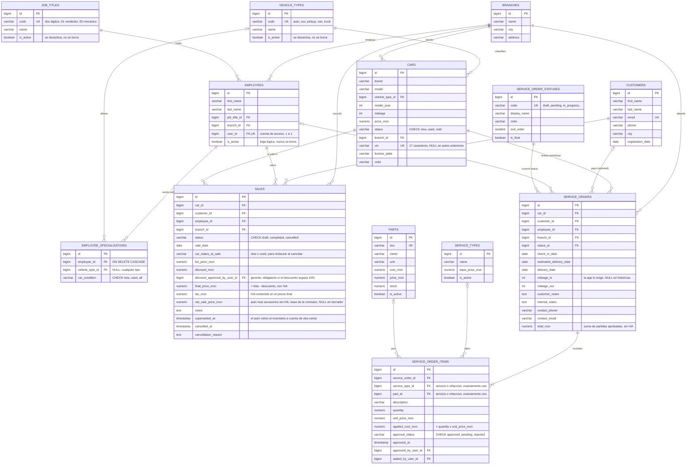

# Modelo de datos: base `agencia`

Agencia de autos con venta de vehículos y taller de servicio, con datos sintéticos. Sirve como fuente para practicar un sistema web (Laravel + Vue con TypeScript) y un pipeline ETL.

Motor: PostgreSQL 17. El esquema vive en dos lugares que deben mantenerse idénticos:

- Migraciones de Laravel: `backend/database/migrations/`
- DDL puro: `database/schema/01_schema.sql`

Este documento detalla las tablas del negocio. Las reglas y flujos de las ventas (autos a cuenta, financiamiento, transferencias, comisiones) están en [`arquitectura-ventas.md`](arquitectura-ventas.md), y las del taller (estatus de las órdenes, refacciones, facturas y pagos) en [`arquitectura_servicios.md`](arquitectura_servicios.md).

Los datos se cargan con `database/schema/02_seed_manual.sql` (conjunto pequeño) y `database/seeds-python/seed.py` (volumen). Ver [`database/seeds-python/README.md`](../database/seeds-python/README.md).

> Para ver todas las tablas en un solo diagrama (negocio, usuarios, roles, permisos y menú), consulta [`diagrama-er.md`](diagrama-er.md).

## Convenciones

El esquema sigue las convenciones de Laravel, para que Eloquent funcione sin configuración extra:

- Tablas en inglés, plural y `snake_case` (`service_orders`).
- Llave primaria `id` (`BIGSERIAL`).
- Llaves foráneas `<singular>_id` (`branch_id`), con las restricciones nombradas como las genera Laravel.
- `created_at` y `updated_at` en todas las tablas.
- Cada tabla y cada columna tiene un comentario en la base de datos (`->comment()` en las migraciones, `COMMENT ON` en `01_schema.sql`) que explica su significado, unidades y valores válidos. Es el diccionario de datos: `\d+ <tabla>` en `psql`, o la columna "Comentario" en HeidiSQL. Las tablas de las secciones siguientes lo resumen.
- Códigos de estado en inglés (`sold`, `in_progress`). Los puestos tienen un código numérico de dos dígitos (`01`, `05`). Los textos que son datos (nombres de personas, ciudades, nombres de servicios) están en español.

## Diagrama entidad-relación

Todas las tablas tienen además `created_at` y `updated_at` (no se dibujan para no saturar el diagrama). Las tablas de ventas (`sale_*`), `service_order_histories`, `invoices` y `payments` se dibujan en [`diagrama-er.md`](diagrama-er.md).

## Tablas

Las llaves foráneas de `employees` y `cars` aceptan `NULL` y no definen `ON DELETE`: el comportamiento por defecto rechaza el borrado de un registro con hijos. En las ventas y el taller (`sales`, `service_orders` y las tablas que dependen de ellas) las llaves de negocio son `ON DELETE RESTRICT`, y las que apuntan a `users` son `ON DELETE SET NULL` (excepto `sales.discount_approved_by_user_id`, que es `RESTRICT`). `created_at` y `updated_at` son `TIMESTAMP(0)` sin zona horaria y aceptan `NULL` (Eloquent los llena al crear y actualizar).

### `branches` (sucursales)

| Columna | Tipo | Restricciones |
| --- | --- | --- |
| `id` | BIGSERIAL | PK |
| `name` | VARCHAR(100) | NOT NULL |
| `city` | VARCHAR(50) | NOT NULL |
| `address` | VARCHAR(150) | NOT NULL |

### `customers` (clientes)

| Columna | Tipo | Restricciones |
| --- | --- | --- |
| `id` | BIGSERIAL | PK |
| `first_name` | VARCHAR(50) | NOT NULL |
| `last_name` | VARCHAR(50) | NOT NULL |
| `email` | VARCHAR(100) | NOT NULL, UNIQUE |
| `phone` | VARCHAR(15) | |
| `city` | VARCHAR(50) | |
| `registration_date` | DATE | Por defecto `2023-01-01` |

### `job_titles` (puestos)

Catálogo de puestos de los empleados. Las migraciones insertan los 5 puestos. Se llama `job_titles` y no `jobs` porque Laravel ya tiene una tabla `jobs` (la cola de trabajos).

| Columna | Tipo | Restricciones |
| --- | --- | --- |
| `id` | BIGSERIAL | PK |
| `code` | VARCHAR(30) | NOT NULL, UNIQUE. `CHECK`: dos dígitos (`^[0-9]{2}$`) |
| `name` | VARCHAR(80) | NOT NULL. Nombre para mostrar |
| `is_active` | BOOLEAN | NOT NULL, por defecto `true`. Un puesto se desactiva, no se borra |

| `code` | `name` |
| --- | --- |
| `01` | Vendedor |
| `02` | Gerente |
| `03` | Asesor de servicio |
| `04` | Jefe Mecánico |
| `05` | Mecánico |

### `job_title_role` (rol sugerido por puesto)

Roles que se sugieren al crear el usuario de un empleado, según su puesto. **No otorga permisos**: el rol real del usuario sigue siendo el de Spatie (`model_has_roles`). Referencia `roles`, así que su migración va después de la de Spatie. Un puesto puede sugerir varios roles.

| Columna | Tipo | Restricciones |
| --- | --- | --- |
| `job_title_id` | BIGINT | PK (compuesta), FK → `job_titles`, `ON DELETE CASCADE` |
| `role_id` | BIGINT | PK (compuesta), FK → `roles`, `ON DELETE CASCADE` |

`RolesSeeder` la llena: `01` → `seller`, `02` → `manager`, `03` → `service_advisor`, `04` → `mechanic` y `05` → `mechanic`. El rol del Jefe Mecánico (`04`) es provisional.

### `employees` (empleados)

| Columna | Tipo | Restricciones |
| --- | --- | --- |
| `id` | BIGSERIAL | PK |
| `first_name` | VARCHAR(50) | NOT NULL |
| `last_name` | VARCHAR(50) | NOT NULL |
| `job_title_id` | BIGINT | NOT NULL, FK → `job_titles`, `ON DELETE RESTRICT`. Puesto del empleado |
| `branch_id` | BIGINT | FK → `branches` |
| `user_id` | BIGINT | FK → `users`, UNIQUE, `ON DELETE SET NULL`. Cuenta de acceso del empleado (1 a 1). Es `NULL` si no usa el sistema |
| `is_active` | BOOLEAN | NOT NULL, por defecto `true`. Un empleado nunca se borra: se da de baja con `false` y conserva su historial |

### `employee_specializations` (especialización de los empleados)

Con qué autos trabaja un empleado, por ejemplo un mecánico solo de `pickup` y `truck`, o un vendedor solo de autos usados. Es independiente del puesto y del rol.

| Columna | Tipo | Restricciones |
| --- | --- | --- |
| `id` | BIGSERIAL | PK |
| `employee_id` | BIGINT | NOT NULL, FK → `employees`, `ON DELETE CASCADE` |
| `vehicle_type_id` | BIGINT | FK → `vehicle_types`, `ON DELETE RESTRICT`. `NULL`: cualquier tipo |
| `car_condition` | VARCHAR(5) | NOT NULL, por defecto `'all'`. `CHECK (car_condition IN ('new', 'used', 'all'))` |

Reglas de lectura:

- **Sin filas:** el empleado atiende cualquier auto.
- **Una fila** es una combinación permitida: el tipo **y** la condición deben coincidir.
- **Varias filas** se suman (**o**): basta con que el auto cumpla una.
- **Unicidad:** `(employee_id, vehicle_type_id, car_condition)` es único con `NULLS NOT DISTINCT`, así que tampoco se repite una fila con tipo `NULL`.

| Caso | Filas |
| --- | --- |
| Mecánico solo de camionetas y camiones | `(pickup, all)`, `(truck, all)` (y `(suv, all)` si "camioneta" incluye SUV) |
| Vendedor solo de autos usados | `(NULL, used)` |
| Vendedor solo de SUV nuevas | `(suv, new)` |
| Vendedor de SUV nuevas o de cualquier usado | `(suv, new)`, `(NULL, used)` |

La base solo guarda los datos. **La aplicación aplica la regla al asignar** (crear o transferir una venta, asignar una orden de servicio): compara el auto con las filas del empleado. La condición del auto es `cars.status` (`new` o `used`). Un gerente puede asignar fuera de la especialización dejando una nota. La especialización no limita qué registros puede ver el empleado. Esa validación todavía no está programada (no existen aún los flujos de ventas y órdenes).

### `vehicle_types` (tipos de vehículo)

Catálogo de carrocerías. Las migraciones insertan los 5 tipos. "Camioneta" no es un tipo porque según el caso es `suv` o `pickup`.

| Columna | Tipo | Restricciones |
| --- | --- | --- |
| `id` | BIGSERIAL | PK |
| `code` | VARCHAR(20) | NOT NULL, UNIQUE |
| `name` | VARCHAR(50) | NOT NULL. Nombre para mostrar |
| `is_active` | BOOLEAN | NOT NULL, por defecto `true`. Un tipo se desactiva, no se borra |

| `code` | `name` |
| --- | --- |
| `auto` | Auto |
| `suv` | SUV |
| `pickup` | Pickup |
| `van` | Van |
| `truck` | Camión |

El seed asigna el tipo por modelo: 16 modelos `auto`, 11 `suv` y 3 `pickup` (Ranger, Hilux y Frontier). No hay modelos `van` ni `truck`.

### `cars` (autos)

| Columna | Tipo | Restricciones |
| --- | --- | --- |
| `id` | BIGSERIAL | PK |
| `brand` | VARCHAR(50) | NOT NULL (marca, por ejemplo `Nissan`) |
| `model` | VARCHAR(50) | NOT NULL (submarca, por ejemplo `Versa`) |
| `vehicle_type_id` | BIGINT | NOT NULL, FK → `vehicle_types`, `ON DELETE RESTRICT`. Tipo de vehículo |
| `model_year` | INTEGER | NOT NULL (año del modelo) |
| `mileage` | INTEGER | NOT NULL. Último kilometraje registrado: se actualiza con cada orden de servicio |
| `price_mxn` | NUMERIC(12,2) | NOT NULL (precio de lista) |
| `status` | VARCHAR(10) | NOT NULL, por defecto `'new'`. `CHECK (status IN ('new', 'used', 'sold'))` |
| `branch_id` | BIGINT | FK → `branches` |
| `vin` | VARCHAR(17) | UNIQUE. `CHECK` de formato: 17 caracteres, letras y dígitos sin `I`, `O` ni `Q`. `NULL` en los autos anteriores al taller |
| `license_plate` | VARCHAR(15) | Con índice. Sin restricción de unicidad: las placas se transfieren |
| `color` | VARCHAR(30) | |

### `sales` (ventas)

Una venta nace en borrador y se cierra o se cancela. Reglas completas en [`arquitectura-ventas.md`](arquitectura-ventas.md).

| Columna | Tipo | Restricciones |
| --- | --- | --- |
| `id` | BIGSERIAL | PK |
| `car_id` | BIGINT | NOT NULL, FK → `cars`, `ON DELETE RESTRICT`. Un auto tiene a lo mucho una venta vigente (índice único parcial) |
| `customer_id` | BIGINT | NOT NULL, FK → `customers`, `ON DELETE RESTRICT` |
| `employee_id` | BIGINT | NOT NULL, FK → `employees`, `ON DELETE RESTRICT`. Vendedor dueño actual de la venta |
| `branch_id` | BIGINT | NOT NULL, FK → `branches`, `ON DELETE RESTRICT` |
| `status` | VARCHAR(10) | NOT NULL, por defecto `'draft'`. `CHECK (status IN ('draft', 'completed', 'cancelled'))` |
| `sale_date` | DATE | NOT NULL. En borrador es la fecha de captura |
| `car_status_at_sale` | VARCHAR(10) | `new` o `used`. Estatus del auto al cerrar la venta. Obligatorio si está cerrada |
| `list_price_mxn` | NUMERIC(12,2) | NOT NULL. Precio de lista al momento de la venta, con IVA |
| `discount_mxn` | NUMERIC(12,2) | NOT NULL, por defecto `0`. Entre 0 y el precio de lista |
| `discount_approved_by_user_id` | BIGINT | FK → `users`. Obligatorio si el descuento supera el 10 % de la lista |
| `final_price_mxn` | NUMERIC(12,2) | NOT NULL. `CHECK`: igual a `list_price_mxn - discount_mxn`. Con IVA, sin accesorios |
| `tax_mxn` | NUMERIC(12,2) | NOT NULL. IVA contenido en el precio final (desglose, no se suma) |
| `net_sale_price_mxn` | NUMERIC(12,2) | Precio neto antes de impuestos: auto más accesorios, sin IVA. Base de la comisión. `NULL` en borrador, obligatorio si está cerrada, y no menor a `final_price_mxn - tax_mxn` |
| `notes` | TEXT | Observaciones |
| `superseded_at` | TIMESTAMP(0) | El auto volvió al inventario a cuenta de otra venta. Solo en ventas cerradas |
| `cancelled_at` | TIMESTAMP(0) | `CHECK`: lleno si y solo si el estatus es `cancelled` |
| `cancellation_reason` | TEXT | Obligatorio si está cancelada |

Índices: `car_id`, `customer_id`, `employee_id`, `sale_date`, `(branch_id, status)` y el único parcial `car_id` (`WHERE status <> 'cancelled' AND superseded_at IS NULL`).

### `service_types` (tipos de servicio)

| Columna | Tipo | Restricciones |
| --- | --- | --- |
| `id` | BIGSERIAL | PK |
| `name` | VARCHAR(100) | NOT NULL |
| `base_price_mxn` | NUMERIC(10,2) | NOT NULL |
| `is_active` | BOOLEAN | NOT NULL, por defecto `true`. Un servicio dado de baja se desactiva, no se borra |

### `service_order_statuses` (estatus de las órdenes)

Catálogo de la máquina de estados de las órdenes. Las migraciones insertan los 7 estatus: `draft`, `pending`, `pending_approval`, `in_progress`, `completed`, `delivered` y `cancelled`.

| Columna | Tipo | Restricciones |
| --- | --- | --- |
| `id` | BIGSERIAL | PK |
| `code` | VARCHAR(30) | NOT NULL, UNIQUE. Identificador estable que usa el código |
| `display_name` | VARCHAR(50) | NOT NULL. Texto para la interfaz |
| `color` | VARCHAR(7) | `CHECK` de formato hexadecimal (`#4CAF50`) |
| `sort_order` | SMALLINT | NOT NULL, por defecto `0` |
| `is_final` | BOOLEAN | NOT NULL, por defecto `false`. Una orden en estatus final ya no cambia |

### `parts` (refacciones)

| Columna | Tipo | Restricciones |
| --- | --- | --- |
| `id` | BIGSERIAL | PK |
| `sku` | VARCHAR(50) | NOT NULL, UNIQUE |
| `name` | VARCHAR(150) | NOT NULL. Con índice |
| `unit` | VARCHAR(10) | NOT NULL, por defecto `'pza'` |
| `cost_mxn` | NUMERIC(10,2) | NOT NULL, `>= 0`. Costo para la agencia |
| `price_mxn` | NUMERIC(10,2) | NOT NULL, `>= 0`. Precio al cliente, sin IVA |
| `stock` | NUMERIC(12,2) | NOT NULL, por defecto `0`, `>= 0`. Admite fracciones (litros) |
| `is_active` | BOOLEAN | NOT NULL, por defecto `true` |

### `service_orders` (órdenes de servicio)

Todas las llaves foráneas son `ON DELETE RESTRICT`.

| Columna | Tipo | Restricciones |
| --- | --- | --- |
| `id` | BIGSERIAL | PK |
| `car_id` | BIGINT | NOT NULL, FK → `cars` |
| `customer_id` | BIGINT | FK → `customers`. `NULL` cuando el auto es de la agencia |
| `employee_id` | BIGINT | FK → `employees`. Empleado que atiende |
| `branch_id` | BIGINT | NOT NULL, FK → `branches` |
| `status_id` | BIGINT | NOT NULL, FK → `service_order_statuses` |
| `check_in_date` | DATE | NOT NULL (ingreso al taller) |
| `estimated_delivery_date` | DATE | Fecha prometida. `CHECK`: no anterior al ingreso |
| `delivery_date` | DATE | Fecha real de entrega. `CHECK`: no anterior al ingreso |
| `mileage_in` | INTEGER | Kilometraje de entrada. La aplicación lo exige; es `NULL` en las órdenes históricas |
| `mileage_out` | INTEGER | Kilometraje de salida. `CHECK`: `>= 0` y `>= mileage_in` |
| `customer_notes` | TEXT | Problemas reportados por el cliente |
| `internal_notes` | TEXT | Notas del taller, no visibles al cliente |
| `contact_phone` | VARCHAR(15) | Copia del teléfono del cliente al momento de la orden |
| `contact_email` | VARCHAR(100) | Copia del correo del cliente al momento de la orden |
| `total_mxn` | NUMERIC(10,2) | NOT NULL, por defecto `0`, `>= 0`. Suma de las partidas aprobadas, sin IVA |

Índices: `car_id`, `customer_id`, `employee_id`, `status_id`, `check_in_date` y `(branch_id, status_id)`.

### `service_order_items` (detalle de servicio)

| Columna | Tipo | Restricciones |
| --- | --- | --- |
| `id` | BIGSERIAL | PK |
| `service_order_id` | BIGINT | NOT NULL, FK → `service_orders`, `ON DELETE RESTRICT` |
| `service_type_id` | BIGINT | FK → `service_types`, `ON DELETE RESTRICT` |
| `part_id` | BIGINT | FK → `parts`, `ON DELETE RESTRICT`. `CHECK`: exactamente uno de `service_type_id` y `part_id` |
| `description` | VARCHAR(255) | NOT NULL. Copia del nombre al momento de la orden |
| `quantity` | NUMERIC(10,2) | NOT NULL, por defecto `1`, `> 0` |
| `unit_price_mxn` | NUMERIC(10,2) | NOT NULL, `>= 0` |
| `applied_cost_mxn` | NUMERIC(10,2) | NOT NULL. `CHECK`: igual a `round(quantity * unit_price_mxn, 2)` |
| `approval_status` | VARCHAR(10) | NOT NULL, por defecto `'approved'`. `CHECK (approval_status IN ('approved', 'pending', 'rejected'))` |
| `approved_at` | TIMESTAMP(0) | Cuándo se registró la respuesta del cliente |
| `approved_by_user_id` | BIGINT | FK → `users`, `ON DELETE SET NULL` |
| `added_by_user_id` | BIGINT | FK → `users`, `ON DELETE SET NULL` |

### Tablas de la venta

Se describen con detalle en [`arquitectura-ventas.md`](arquitectura-ventas.md#21-tablas-nuevas). Todas las llaves de negocio son `ON DELETE RESTRICT`.

| Tabla | Para qué sirve | Restricciones destacadas |
| --- | --- | --- |
| `sale_addons` | Accesorios vendidos con el auto (placas, seguros, tapetes) | `part_id` opcional. `total_mxn = round(quantity * unit_price_mxn, 2)`. Cantidad mayor que cero |
| `sale_trade_ins` | Auto que el cliente entrega como parte de pago (copia de sus datos) | `car_id` es `NULL` hasta cerrar la venta. VIN con formato válido. Kilometraje y valuación no negativos |
| `sale_financings` | Financiamiento de la venta a crédito | `sale_id` único (un crédito por venta). Plazo de 1 a 120 meses. Banco obligatorio si `lender_type = 'bank'`. Fecha de aprobación si y solo si está `approved` o `disbursed` |
| `sale_transfers` | Historial de cambios de vendedor (solo se inserta) | `from_employee_id <> to_employee_id`. `authorized_by_user_id` es `NULL` si el dueño transfiere su propio borrador |
| `commission_rules` | Reglas de comisión por sucursal (`NULL` = global) y condición del auto (`new`, `used`, `all`) | `rate` entre 0 y 1 (fracción: 0.0150 = 1.5 %). Una sola regla por sucursal, condición y fecha de vigencia, también entre las globales (`NULLS NOT DISTINCT`) |
| `sale_commissions` | Reparto de la comisión entre quien captura y quien cierra | Un vendedor por venta (`UNIQUE (sale_id, employee_id)`). Rol `sole`, `capturer` o `closer`. Guarda la regla aplicada, la base (precio neto antes de impuestos), la tasa copiada y el reparto. `CHECK`: importe = base × tasa × porcentaje / 100 (un centavo de tolerancia), y nunca mayor a la base |

### Bitácora, facturas y pagos

`service_order_histories`, `invoices` y `payments` (que también paga las ventas: `method` incluye `financing` y `trade_in`) se describen en [`arquitectura_servicios.md`](arquitectura_servicios.md#21-tablas-nuevas) y se dibujan en [`diagrama-er.md`](diagrama-er.md).

## Timestamps en los seeds

Los seeds fijan `created_at` y `updated_at` con valores determinísticos derivados de las fechas de negocio, para que la carga sea reproducible:

| Tabla | `created_at` | `updated_at` |
| --- | --- | --- |
| `branches`, `employees`, `service_types` | `2021-01-01` | `2021-01-01` |
| `customers` | `registration_date` | `registration_date` |
| `cars` | `2021-01-01` | `sale_date` si está vendido, si no `2021-01-01` |
| `sales` | `sale_date` | `sale_date` |
| `service_orders` | `check_in_date` | `delivery_date` |
| `service_order_items` | `check_in_date` de su orden | igual que `created_at` |
| `service_order_statuses` | Fecha en que corrió la migración | igual que `created_at` |

Las filas que cree la aplicación recibirán la hora real, por lo que una extracción incremental podrá distinguir los datos nuevos de los del seed.

## Equivalencias con los nombres anteriores

El modelo original (MySQL) usaba nombres en español. Los datos son los mismos: se comprobaron fila por fila al renombrar.

| Anterior | Actual |
| --- | --- |
| `sucursales` | `branches` |
| `clientes` | `customers` |
| `empleados` | `employees` |
| `autos` | `cars` |
| `ventas` | `sales` |
| `tipos_servicio` | `service_types` |
| `ordenes_servicio` | `service_orders` |
| `detalle_servicio` | `service_order_items` |
| `id_<tabla>` (PK) | `id` |
| `id_<tabla>` (FK) | `<singular>_id` (`id_sucursal` → `branch_id`) |
| `nombre`, `apellido`, `telefono`, `ciudad`, `direccion` | `first_name`/`name`, `last_name`, `phone`, `city`, `address` |
| `fecha_registro` | `registration_date` |
| `puesto` | `job_title_id` (FK al catálogo `job_titles`) |
| `marca`, `submarca`, `modelo` | `brand`, `model`, `model_year` |
| `kilometraje`, `estado` | `mileage`, `status` |
| `precio_mxp`, `precio_final_mxp`, `total_mxp`, `precio_base`, `costo_aplicado` | `price_mxn`, `final_price_mxn`, `total_mxn`, `base_price_mxn`, `applied_cost_mxn` |
| `fecha_venta`, `fecha_ingreso`, `fecha_entrega` | `sale_date`, `check_in_date`, `delivery_date` |
| Estados `Nuevo`, `Usado`, `Vendido` | `new`, `used`, `sold` |
| Puestos `Vendedor`, `Gerente`, `Asesor de Servicio`, `Mecánico` | `seller`, `manager`, `service_advisor`, `mechanic` |

La moneda pasó de `mxp` a `mxn`: `MXN` es el código ISO del peso mexicano actual, y `MXP` el del peso anterior a 1993.

## Particularidades a tener en cuenta

Estos puntos importan al diseñar el sistema y el pipeline ETL:

- **Los ids no siguen el orden cronológico.** Las 12 ventas del seed manual son de 2024 y tienen los ids 1 a 12, mientras que las del seed masivo empiezan en 2022 con el id 13. Para análisis temporales, ordena por fecha y no por id.
- **Hay órdenes anteriores a 2022.** Las revisiones previas a la venta pueden caer antes de `fecha_inicio` (la fecha mínima es 2021-12-23).
- **`service_orders.customer_id` es `NULL` en 619 de 4,008 órdenes** (revisiones previas e inventario). Un `JOIN` interno con `customers` las descarta, y es un buen caso para practicar.
- **Las ventas históricas también.** Las 2,012 ventas se cargan como `completed`, con la sucursal del auto, el precio de lista del auto, el descuento como diferencia con el precio final, el IVA del 16 % contenido y el precio neto (final menos IVA, sin accesorios). No tienen accesorios, autos a cuenta, financiamiento, transferencias, comisiones, factura ni pagos.
- **Las órdenes históricas están incompletas a propósito.** Las 4,008 órdenes se cargan como `delivered`, con la sucursal del auto, y sus partidas con cantidad `1`. No tienen `mileage_in`, `mileage_out`, notas ni datos de contacto (`NULL`), ni bitácora, factura o pagos. Por eso esas columnas son nullable en la base y la aplicación exige los datos solo en las órdenes nuevas.
- **Datos del seed manual inconsistentes con la sucursal.** Las órdenes 4, 5 y 8 tienen un empleado de una sucursal distinta a la del auto. Los datos del seed masivo no tienen este problema.
- **Los datos son limpios.** No hay duplicados, nulos inesperados, valores atípicos ni errores de formato. Para practicar limpieza y validación en el ETL, ensúciales aparte con `database/seeds-python/noise.py` sobre una copia, sin editar los seeds.
- **Los timestamps de los seeds no son de auditoría real.** Salen de las fechas de negocio (ver arriba). Solo las filas que cree o modifique la aplicación tendrán `created_at` y `updated_at` reales.
- **Eloquent no necesita configuración extra.** `Car`, `Sale`, `ServiceOrderItem`, etc. encuentran su tabla y su llave por convención, y `belongsTo(Branch::class)` deduce `branch_id`.
- **`status` en `cars` es texto con `CHECK`.** En TypeScript se representa como el tipo unión `'new' | 'used' | 'sold'`, y el puesto como el `code` de `job_titles` (`'01' | '02' | '03' | '04' | '05'`) o, mejor, con el catálogo que entrega la API. Los campos `NUMERIC` llegan como cadena en JSON desde Laravel, así que conviene convertirlos a número en el frontend. El texto para mostrar al usuario ("Vendido") se traduce en la interfaz.
